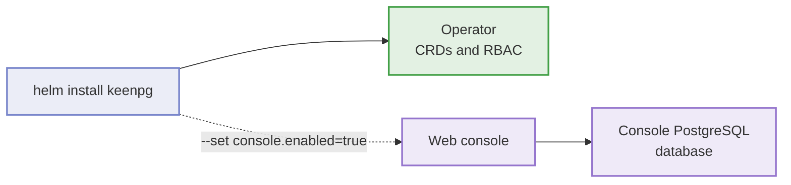

# keenpg-operator Helm chart

Installs the KeenPG operator (`KeenPGCluster`, `PGUpgrade`, `PGAdmin` CRDs) and,
optionally, the KeenPG web console with its own PostgreSQL database.



This chart is the Helm equivalent of the kustomize targets in `config/`:

| kustomize | Helm |
| :---- | :---- |
| `config/default` | defaults (operator + CRDs + RBAC) |
| `config/keenpg` | `--set console.enabled=true` |
| `config/singlenamespace` | `--set rbac.clusterWide=false` |

## Install

```bash title="Install the operator"
git clone https://github.com/keenpg/keenpg-helm-charts.git

cd keenpg-helm-charts/

helm install keenpg . --namespace keenpg-operator --create-namespace
```

With the web console enabled:

```bash title="Install with the web console"
helm install keenpg ./keenpg-operator -n keenpg-operator --create-namespace \
  --set console.enabled=true
```

Private `quay.io/keenpg` repositories:

```bash title="Install with a pull secret"
helm install keenpg ./keenpg-operator -n keenpg-operator --create-namespace \
  --set pullSecret.create=true \
  --set-file pullSecret.dockerconfigjson=$HOME/.config/containers/auth.json
```

Console login (a random admin password is generated unless you set
`console.admin.password`):

```bash title="Read the admin password and open the console"
kubectl -n keenpg-operator get secret keenpgo-console-admin \
  -o jsonpath='{.data.password}' | base64 -d; echo
kubectl -n keenpg-operator port-forward svc/keenpgo-console 8080:80
```

## Main values

| Key | Default | Description |
| :---- | :---- | :---- |
| `operator.image.repository` / `.tag` | `quay.io/keenpg/keenpgo` / `v6.0` | Operator image |
| `operator.debug` | `false` | `KEENPG_DEBUG` (the kustomize manifest ships `true`) |
| `operator.featureGates` | `""` | `KEENPG_FEATURE_GATES` |
| `rbac.clusterWide` | `true` | `false` = Role/RoleBinding + `KEENPG_TARGET_NAMESPACE` |
| `rbac.name` | `keenpg-operator` | ClusterRole name (change for multiple installs) |
| `relatedImages.*` | see `values.yaml` | `RELATED_IMAGE_*` images for Postgres, pgBackRest, pgBouncer, exporter, upgrade, pgAdmin, collector |
| `pullSecret.*` | off | Create/use the registry pull Secret |
| `console.enabled` | `false` | Deploy console + console DB |
| `console.service.type` | `ClusterIP` | Use `NodePort` + `nodePort: 30080` for the upstream behaviour |
| `console.ingress.*` | off | Optional Ingress |
| `console.db.storage.size` | `10Gi` | Console DB volume |

## Notes

!!! warning "Console DB password persistence"
    The console DB password Secret (`keenpgo-console-db`) is generated once and
    kept on `helm uninstall` (`helm.sh/resource-policy: keep`), because the
    PVC also survives and the database keeps its first password. Delete both to
    start from scratch.

!!! info "Namespace scoping"
    Console, console DB and their Secret/ConfigMap/PVC names are fixed (the
    console finds them by name): one console per namespace.

!!! note "Monitoring stack"
    The monitoring stack under `config/monitoring` (Prometheus, Grafana,
    Alertmanager) is not part of this chart.