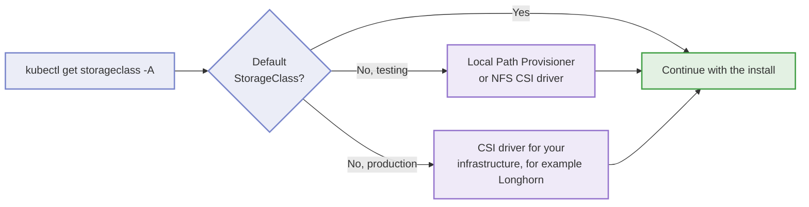
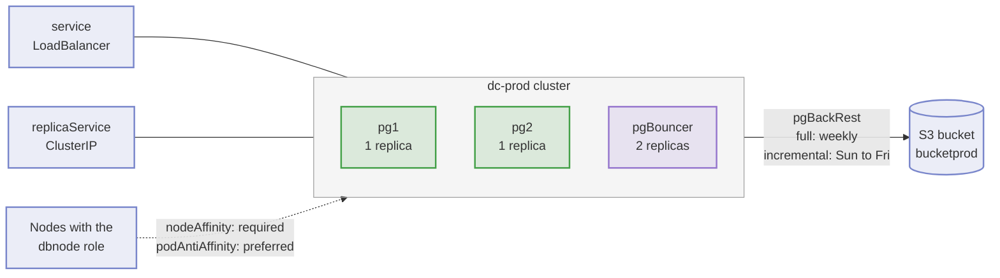

# Installation of keenPGO on Kubernetes Engine installed via RKE2

In this documentation you will be deploying  keenPGO on
[Rancher Kubernetes Engine (RKE2) :octicons-link-external-16:](https://docs.rke2.io/).
RKE2 is a Kubernetes distribution that you can run standalone or
manage with the [Rancher :octicons-link-external-16:](https://ranchermanager.docs.rancher.com/)
Kubernetes management platform.

This document assumes basic familiarity with the platform. Please consult the user manual for further information. [RKE2 official documentation :octicons-link-external-16:](https://docs.rke2.io/).

## Contents

<div class="grid cards" markdown>

-   :material-clipboard-check-outline:{ .lg .middle } __Prepare__

    ---

    - [Prerequisites](#prerequisites)
    - [Create the RKE2 cluster](#create-the-rke2-cluster)
    - [Configure kubectl access](#configure-kubectl-access)
    - [Configure storage](#configure-storage)

-   :material-rocket-launch:{ .lg .middle } __Deploy__

    ---

    - [Install the Operator and deploy your PostgreSQL cluster](#install-the-operator-and-deploy-your-postgresql-cluster)
    - [Production ready Sample DB yaml for PROD workload](#production-ready-sample-db-yaml-for-prod-workload)

-   :material-check-decagram-outline:{ .lg .middle } __Verify and remove__

    ---

    - [Verifying the cluster operation](#verifying-the-cluster-operation)
    - [Removing the RKE2 cluster](#removing-the-rke2-cluster)

</div>


## Prerequisites

Ensure you have the following setup and credentials::

| You need | Details |
| :---- | :---- |
| :material-linux: **Linux hosts** | Compliant with the [RKE2 requirements :octicons-link-external-16:](https://docs.rke2.io/install/requirements). For production-grade environments, deploy a minimum of 3 nodes to allow the Operator to distribute workloads as outlined in [system requirements](System-Requirements.md). |
| :material-shield-key-outline: **Root or sudo** | Access on each host to install and start RKE2 services. |
| :material-console: **kubectl** | To manage and deploy applications on Kubernetes. Install it [following the official installation instructions :octicons-link-external-16:](https://kubernetes.io/docs/tasks/tools/install-kubectl/). RKE2 also ships a `kubectl` binary under `/var/lib/rancher/rke2/bin/` on server nodes. |

## Create the RKE2 cluster

You can create the cluster [with the RKE2 installation script :octicons-link-external-16:](https://docs.rke2.io/install/quickstart) or [provision it
through Rancher :octicons-link-external-16:](https://ranchermanager.docs.rancher.com/how-to-guides/new-user-guides/launch-kubernetes-with-rancher). Both approaches give you a standard Kubernetes API endpoint
that the Operator uses.

## Configure kubectl access

On a server node, RKE2 writes the kubeconfig to `/etc/rancher/rke2/rke2.yaml`.
Copy it to your workstation and point `kubectl` at it:

```bash title="Configure kubectl"
mkdir -p ~/.kube
sudo cat /etc/rancher/rke2/rke2.yaml > ~/.kube/rke2.yaml
export KUBECONFIG=~/.kube/rke2.yaml
```

If you connect from a remote machine, replace `127.0.0.1` in the kubeconfig
`server:` URL with the reachable address of your RKE2 server node.

Verify that the nodes are ready:

```bash title="Check the nodes"
kubectl get nodes
```

## Configure storage

keenPGO needs PersistentVolumes for database data. Confirm
that your cluster has a default StorageClass:

```bash title="Check the StorageClass"
kubectl get storageclass -A
```


!!! note

    RKE2 does not always ship a default StorageClass. For testing, you can install via local storage or NFS CSI driver for dev
    the [Local Path Provisioner :octicons-link-external-16:](https://github.com/rancher/local-path-provisioner).
    For production, use a CSI driver appropriate for your infrastructure, such as
    [Longhorn :octicons-link-external-16:](https://longhorn.io/) when you manage the cluster with Rancher.

## Install the Operator and deploy your PostgreSQL cluster

1. Create the Kubernetes namespace for your cluster. It is a good practice to isolate workloads in Kubernetes by installing the Operator in a custom namespace.

    ```bash title="Create the namespace"
    kubectl create ns keenpg-operator
    ```

2. Deploy the Operator using the following command:

    ```bash title="Deploy the Operator"
    git clone https://github.com/keenpg/keenpg-operator.git -b 6.0
    
    kubectl apply --server-side -f config/keenpg -n keenpg-operator
    ```

    At this point, the Operator Pod is up and running.

3. Once the Operator has been started and console Pod and Console DB pods are up, and you can deploy DB instance via CLI or UI:
   Sample DB Yaml with name database.yaml.

    ```yaml title="database.yaml"
    apiVersion: keenpg.io/v1beta1
    kind: KeenPGCluster
    metadata:
      name: cluster1
    spec:
      postgresVersion: 17
      instances:
        - dataVolumeClaimSpec:
            accessModes: ["ReadWriteOnce"]
            resources:
              requests:
                storage: 1Gi
      backups:
        pgbackrest:
          repos:
            - name: repo1
              volume:
                volumeClaimSpec:
                  accessModes: ["ReadWriteOnce"]
                  resources:
                    requests:
                      storage: 1Gi
    ```

    ```bash title="Deploy the database"
    kubectl apply -f database.yaml 
    ```

    ```bash title="Check the cluster"
    kubectl get keenpg 
    ```

## Production ready Sample DB yaml for PROD workload.

Please find the sample production DB cluster yaml which is being by our customer for big database size and high workload .


??? info "Production DB cluster yaml (dc-prod)"

    ```yaml title="dc-prod.yaml"
    apiVersion: keenpg.io/v1
    kind: KeenPGCluster
    metadata:
      name: dc-prod
    spec:
      postgresVersion: 16
      image: registry.kubernetes.com:5000/rancher/postgres:ubi9-16.9-2520

    ######## INSTANCE PG1#########
      instances:
        - name: pg1
          replicas: 1

          resources:
            limits:
              hugepages-2Mi: 130872Mi
              memory: 116Gi

          dataVolumeClaimSpec:
            storageClassName: vsphere-csi-storageclass
            accessModes:
            - "ReadWriteOnce"
            resources:
              requests:
                storage: 18000Gi
          affinity:
            podAntiAffinity:
              preferredDuringSchedulingIgnoredDuringExecution:
              - weight: 1
                podAffinityTerm:
                  topologyKey: kubernetes.io/hostname
                  labelSelector:
                    matchLabels:
                      keenpgo.keeng.in/cluster: dc-prod
                      keenpgo.keeng.in/instance-set: pg1
            nodeAffinity:
              requiredDuringSchedulingIgnoredDuringExecution:
                nodeSelectorTerms:
                  - matchExpressions:
                      - key: node-role.kubernetes.io/dbnode
                        operator: In
                        values:
                          - dbnode                    
    ######### INSTANCE PG2#########

        - name: pg2
          replicas: 1

          resources:
            limits:
              hugepages-2Mi: 130872Mi
              memory: 116Gi

          dataVolumeClaimSpec:
            storageClassName: vsphere-csi-storageclass
            accessModes:
            - "ReadWriteOnce"
            resources:
              requests:
                storage: 18000Gi

          affinity:
            podAntiAffinity:
              preferredDuringSchedulingIgnoredDuringExecution:
              - weight: 1
                podAffinityTerm:
                  topologyKey: kubernetes.io/hostname
                  labelSelector:
                    matchLabels:
                      keenpgo.keeng.in/cluster: dc-prod
                      keenpgo.keeng.in/instance-set: pg2

            nodeAffinity:
              requiredDuringSchedulingIgnoredDuringExecution:
                nodeSelectorTerms:
                  - matchExpressions:
                      - key: node-role.kubernetes.io/dbnode
                        operator: In
                        values:
                          - dbnode


      service:
        type: LoadBalancer

      replicaService:
        type: ClusterIP

      backups:
        pgbackrest:
          image: registry.kubernetes.com:5000/rancher/postgres:ubi9-2.54.2-2520
          configuration:
          - secret:
              name: keenpgo-s3-creds
          global:
            repo1-path: /pgbackrest/keenpgo/dc-prod/repo2
            repo1-retention-full: "7"
            process-max: "32"
            repo1-storage-verify-tls: "n"
            repo1-retention-full-type: "time"
            archive-get-queue-max: "100GiB"
            archive-async: "y"
            log-level-file: detail
            log-level-console: detail
            repo1-storage-port: "443"
            repo1-s3-uri-style: "path"
            spool-path: "/pgdata/pgbackrest/spool"
            archive-missing-retry: "y"
          repos:
          - name: repo1
            s3:
              bucket: "bucketprod"
              endpoint: "192.168.122.23"
              region: "us-east-1"
            schedules:
              full: "30 10 * * 6"
              incremental: "30 13 * * 0-5"

      standby:
        enabled: false
        repoName: repo1

      patroni:
        dynamicConfiguration:
          failsafe_mode: true
          postgresql:
            pg_hba:
              - 'local    all         appadmin                trust'
              - 'hostssl replication replicator all scram-sha-256'
              - 'host     all         pgagent       0.0.0.0/0   trust'  
              - 'host     all   keenpgo_monitoring   0.0.0.0/0   trust'
              - 'host     all         all       0.0.0.0/0   md5'

            parameters:
              shared_preload_libraries: 'timescaledb,pg_cron'
              autovacuum: 'on'
              cron.host: '/tmp/postgres'
              cron.database_name: 'postgres'
              cron.timezone: 'Asia/Kolkata'
              autovacuum_naptime: 10s
              checkpoint_timeout: 15min
              jit: off
                #effective_cache_size: 96GB
              log_destination: stderr
              log_line_prefix: '%m [%p] %q%u@%d/%a %h'
              log_min_duration_statement: -1
              log_temp_files: 0
              logging_collector: true
              log_filename: 'postgresql-%Y-%m-%d.log'
              log_rotation_age: 1440
              log_rotation_size: 0
              log_truncate_on_rotation: false
                #maintenance_work_mem: 768MB
              max_connections: 4000
              max_replication_slots: 10
              max_wal_size: 8GB
              min_wal_size: 1GB
              wal_keep_size: 500GB
              shared_buffers: 80GB
              huge_pages: try
              effective_cache_size: 185GB
              maintenance_work_mem: 8GB
              max_worker_processes: 64
              max_parallel_workers: 48
              max_parallel_workers_per_gather: 4
              work_mem: 16MB
              temp_buffers: 16MB
              effective_io_concurrency: 200
              max_parallel_maintenance_workers: 4
              autovacuum_work_mem: 2GB
              checkpoint_completion_target: 0.9
              wal_compression: lz4
              autovacuum_max_workers: 5
              autovacuum_vacuum_scale_factor: 0.02
              autovacuum_vacuum_threshold: 1000
              autovacuum_analyze_scale_factor: 0.01
              autovacuum_analyze_threshold: 1000
              autovacuum_vacuum_insert_scale_factor: 0.05
              autovacuum_vacuum_insert_threshold: 5000
              autovacuum_vacuum_cost_delay: 2ms
              autovacuum_vacuum_cost_limit: 2000
              log_autovacuum_min_duration: 1min
              maintenance_io_concurrency: 100
              track_io_timing: on
              track_wal_io_timing: on
              track_activity_query_size: 4096
              pg_stat_statements.max: 10000
              pg_stat_statements.track: top
              pg_stat_statements.save: on
                #pgaudit.log: read, write
                #pgaudit.log_catalog: false
                #pgaudit.log_client: false
                #pgaudit.log_level: LOG
                #pgaudit.log_parameter: true
                #pgaudit.log_relation: true
                #pgaudit.log_rows: false
                #pgaudit.log_statement: true
                #pgaudit.log_statement_once: true
              random_page_cost: 1.1
              timezone: Asia/Kolkata
              port: "6657"
              wal_buffers: 16MB            


      monitoring:
         pgmonitor:
            exporter:
                image: registry.kubernetes.com:5000/rancher/postgres-exporter:ubi9-0.17.1-2520

      port: 6657
      proxy:
        pgBouncer:
          image: registry.kubernetes.com:5000/rancher/pgbouncer:ubi9-1.24-2520
          replicas: 2
          affinity:
            podAntiAffinity:
              preferredDuringSchedulingIgnoredDuringExecution:
              - weight: 1
                podAffinityTerm:
                  topologyKey: kubernetes.io/hostname
                  labelSelector:
                    matchLabels:
                      keenpgo.keeng.in/cluster: dc-prod
                      keenpgo.keeng.in/role: pgbouncer
            nodeAffinity:
              requiredDuringSchedulingIgnoredDuringExecution:
                nodeSelectorTerms:
                  - matchExpressions:
                      - key: node-role.kubernetes.io/dbnode
                        operator: In
                        values:
                          - dbnode
    ```

!!! warning

    This is a suggestion only, to understand the production DB Yaml only!

## Verifying the cluster operation

Documentation team is working on it.

## Removing the RKE2 cluster

To delete a manually installed RKE2 cluster, run the uninstall script on each
node (agent nodes first, then server nodes):

```bash title="Uninstall RKE2"
/usr/local/bin/rke2-uninstall.sh
```

!!! warning

    After deleting the cluster, all data stored in it will be lost!