# KeenPG Console

The **KeenPG console** is a web page for running PostgreSQL on Kubernetes and OpenShift. From your browser you can create databases, connect applications, take backups and restore them, run SQL on the primary or on a replica, and watch every database on Grafana dashboards. You never need to write YAML.

This page explains every part of the console in simple words, with screenshots.

!!! abstract "What you will learn"

    - Install the console and sign in for the first time.
    - Create, monitor and manage PostgreSQL clusters.
    - Connect your application to a database.
    - Back up, restore and clone your data.
    - Run SQL, manage databases and read the dashboards.
    - Fix the most common problems.

## Contents

<div class="grid cards" markdown>

-   :material-rocket-launch:{ .lg .middle } __Get started__

    ---

    - [How the console works](#how-the-console-works)
    - [Words you will see](#words-you-will-see)
    - [Install with Helm](#install-with-helm)
    - [Sign in](#sign-in)
    - [HTTPS and the certificate](#https-and-the-certificate)

-   :material-monitor-dashboard:{ .lg .middle } __Use the console__

    ---

    - [The screen layout](#the-screen-layout)
    - [Home](#home)
    - [Create a cluster](#create-a-cluster)
    - [Clusters list](#clusters-list)
    - [Inside a cluster](#inside-a-cluster)
    - [Monitoring and logging](#monitoring-and-logging)

-   :material-database-cog:{ .lg .middle } __Work with your data__

    ---

    - [Connect your application](#connect-your-application)
    - [Backup and restore](#backup-and-restore)
    - [SQL Editor](#sql-editor)
    - [Databases](#databases)
    - [Observability](#observability)

-   :material-cog-transfer:{ .lg .middle } __Manage and grow__

    ---

    - [Discovery](#discovery)
    - [Migration](#migration)
    - [Users and access](#users-and-access)
    - [Other pages](#other-pages)
    - [Upgrade the console](#upgrade-the-console)

-   :material-lifebuoy:{ .lg .middle } __Get help__

    ---

    - [Common tasks](#common-tasks)
    - [Troubleshooting](#troubleshooting)
    - [Be careful](#be-careful)

</div>

## How the console works

The path of every request, from your browser to your PostgreSQL clusters:

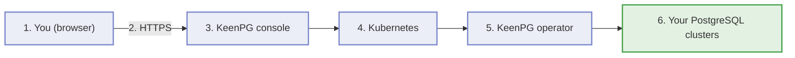

1. **You** fill a form or press a button in the console.
2. **The console** checks that you are allowed to do this. It then saves your request in Kubernetes as a `KeenPGCluster` object and writes an entry in the audit log.
3. **The KeenPG operator**, a program running inside your Kubernetes, sees the request. It creates everything the database needs: pods, disks, network services, passwords, certificates and backup jobs.
4. **The operator keeps watching.** If a pod crashes, a disk is lost or someone deletes a service by mistake, the operator puts it back.

!!! tip "The console and the command line always agree"

    For clusters, backups and settings, the console only writes the same objects you could write with `kubectl`. Only the **SQL Editor** and **Databases** pages talk to PostgreSQL directly, like any SQL tool.

!!! note "Your databases don't depend on the console"

    If the console stops, your databases keep running.

!!! note "Your databases don't depend on the operator either"

    If the operator stops, they keep running and failover still works. Only new changes wait until it is back.

## Words you will see

| Word | Meaning |
| :---- | :---- |
| **Project** | A group of databases. In Kubernetes this is a *namespace*, for example `apps` or `analytics`. **All projects** shows every project at once. |
| **Cluster** | One PostgreSQL database service: one primary and its replicas. |
| **Primary** (also *leader*) | The main server. All writes go here. |
| **Replica** (also *standby*) | A live copy of the primary. It can serve reads and takes over if the primary fails. |
| **Sync standby** | A replica that confirms every write before the primary says "done", so no data is lost if the primary fails. |
| **Failover** | A replica becomes the primary **automatically** because the primary stopped. |
| **Switchover** | You move the primary role to a replica **on purpose**, for example before maintenance. |
| **Lag** | How far a replica is behind the primary. `0 B` means fully up to date. |
| **Patroni** | The tool inside each pod that chooses the primary and handles failover. |
| **pgBackRest** | The backup tool. |
| **Repository (repo)** | Where backups are kept: a disk inside Kubernetes, or object storage (S3, GCS, Azure). |
| **Point-in-time restore** | Restoring a database to an exact moment, for example "yesterday at 10:15". |
| **PgBouncer** | A connection pooler. Many application connections share a few database connections. |
| **Secret** | A safe place in Kubernetes for passwords, keys and certificates. |
| **Collector** | A small helper container added to each database pod when **Monitoring** is on. It collects metrics and, with **Logging**, the logs. |
| **Prometheus / Loki / Grafana** | Prometheus stores the metrics, Loki stores the logs, Grafana shows both as dashboards. |

How the main parts fit together:
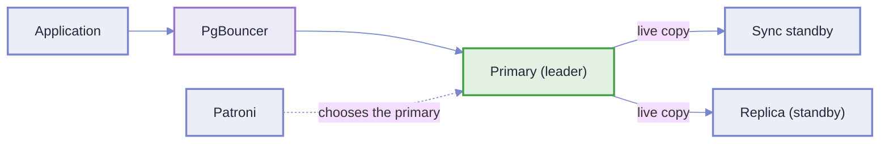

## Install with Helm

!!! note "Already installed?"

    **Skip this part** if KeenPG is already installed for you.

**Install the chart**

Run this from the folder that holds the chart. It installs everything: the operator, the console and the console's own database.

```sh title="Install KeenPG"
helm install keenpg ./keenpg-operator -n keenpg-operator --create-namespace
```

Wait until all pods are **Running**:

```sh title="Check the pods"
kubectl -n keenpg-operator get pods
```

```text title="Expected output"
NAME                                READY   STATUS    RESTARTS   AGE
keenpgo-7b8d8dcc4f-tjnht            1/1     Running   0          2m
keenpgo-console-6797b94dc-rdl5j     1/1     Running   0          2m
keenpgo-console-db-0                1/1     Running   0          2m
```

### Open the console

The console service is only reachable inside Kubernetes. To open it from your browser, change the service to **NodePort**:

```sh title="Expose the console"
kubectl -n keenpg-operator patch svc keenpgo-console -p '{"spec":{"type":"NodePort"}}'
kubectl -n keenpg-operator get svc keenpgo-console
```

```text title="Expected output"
NAME              TYPE       CLUSTER-IP     EXTERNAL-IP   PORT(S)                      AGE
keenpgo-console   NodePort   10.96.120.15   <none>        80:31847/TCP,443:30512/TCP   5m
```

Open **`https://<node IP>:<node port>`**, for example `https://192.168.49.2:30512`. (On minikube, `minikube ip` gives the node IP.)

!!! warning "Certificate warning on first visit"

    The first time, the browser warns that the certificate is not trusted. That is expected: the console made its own certificate. Click **Advanced → Continue**, or see [HTTPS and the certificate](#https-and-the-certificate).

### Optional: dashboards and logs

Install these once if you want the **Observability › Dashboards** page and the **Monitoring** and **Logging** switches:

```sh title="Install monitoring and logging"
kubectl apply -k config/monitoring      # Prometheus, Grafana, Alertmanager
kubectl apply -k config/logging         # Loki, only if you want logs
```

## Sign in

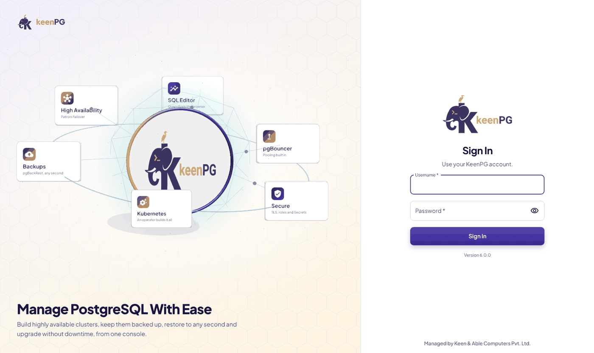

*Sign-in page*

1. Open the console address in your browser.
2. Type your **username** and **password**, then click **Sign In**.

**The first password**

Helm makes a random password for the user `admin` and keeps it in the Secret `keenpgo-console-admin`. Read it with:

```sh title="Read the admin username and password"
kubectl -n keenpg-operator get secret keenpgo-console-admin -o jsonpath='{.data.username}' | base64 -d; echo
kubectl -n keenpg-operator get secret keenpgo-console-admin -o jsonpath='{.data.password}' | base64 -d; echo
```

```text title="Example output"
admin
x7Rk2pQw9LmZ4vTnB8sD   (yours is different)
```

To choose the password yourself, add `--set console.admin.password='Choose-A-Password-1'` to `helm install`.

!!! note "The Secret is only read once"

    It is read when the console starts for the first time and there is no admin yet. After that, the password lives in the console's own database. If you change it in the console, the Secret no longer shows it.

!!! warning "Change the admin password on day one"

    Click your name (top right) → **Change password**.

You stay signed in for 12 hours. To sign out, click your name → **Sign out**.

**Reset a forgotten password**

??? question "Forgot the admin password?"

    Remove the admin user from the console database and restart the console. It then creates `admin` again with the password from the Secret above. Other users, the audit log and settings are kept.

    ```mermaid
    flowchart LR
        A["1. Remove the admin user from the console database"] --> B["2. Restart the console"]
        B --> C["3. Console creates admin again with the password from the Secret"]

        classDef step fill:#7986cb26,stroke:#7986cb,stroke-width:2px
        classDef ok fill:#43a04726,stroke:#43a047,stroke-width:2px
        class A,B step
        class C ok
    ```

    ```sh title="Reset the admin user"
    kubectl -n keenpg-operator exec keenpgo-console-db-0 -- sh -c "PGPASSWORD=\"\$POSTGRES_PASSWORD\" \$(ls -d /usr/pgsql-*/bin | tail -1)/psql -h /tmp -U keenpgo -d keenpgo -c \"DELETE FROM console_users WHERE username = 'admin';\""
    kubectl -n keenpg-operator rollout restart deploy/keenpgo-console
    ```

    `DELETE 1` means it worked.

**Other users** forgot their password? An admin resets it in **Settings → Users** (key icon).

## HTTPS and the certificate

The console always uses **HTTPS**. It makes its own **self-signed certificate** the first time it starts, and keeps it in the Secret `keenpgo-console-tls`.

- Nothing else is needed: no cert-manager and no extra job. It works the same with Helm, kubectl, Argo CD and OpenShift.
- Every console pod and every restart uses the same certificate. It is valid for 2 years; the console makes a new one 30 days before it ends.
- `http://` on the same port is sent on to `https://` by itself.

**Stop the browser warning**

Save the certificate and trust it on your computer (it is its own authority):

```sh title="Save the certificate"
kubectl -n keenpg-operator get secret keenpgo-console-tls -o jsonpath='{.data.tls\.crt}' | base64 -d > keenpg-console.crt
```

Then trust it on your system:

<div class="grid cards os-cards" markdown>

-   :fontawesome-brands-windows:{ .lg .middle } __Windows__

    ---

    1. Double-click the file
    2. **Install Certificate**
    3. *Local Machine*
    4. *Trusted Root Certification Authorities*

-   :fontawesome-brands-apple:{ .lg .middle } __macOS__

    ---

    1. Open it in **Keychain Access**
    2. *System*
    3. Set *Always Trust*

-   :fontawesome-brands-linux:{ .lg .middle } __Linux (Chrome / Firefox)__

    ---

    1. Browser settings
    2. *Certificates*
    3. *Authorities*
    4. **Import**

</div>

**Advanced HTTPS setups**

=== "Your address in the certificate"

    By default the certificate is for the console's service names and `localhost`. To add the IP or name people type in the browser, set `KEENPGO_TLS_HOSTS` and let the console make a new certificate:

    ```sh
    kubectl -n keenpg-operator set env deploy/keenpgo-console KEENPGO_TLS_HOSTS=192.168.49.2,console.example.com
    kubectl -n keenpg-operator delete secret keenpgo-console-tls
    kubectl -n keenpg-operator rollout restart deploy/keenpgo-console
    ```

=== "Your own certificate"

    Use this for a certificate from your company's authority or cert-manager.

    Put it in the same Secret. The console uses it as it is, never replaces it, and picks up a renewed one within 5 minutes:

    ```sh
    kubectl -n keenpg-operator create secret tls keenpgo-console-tls --cert=console.crt --key=console.key \
      --dry-run=client -o yaml | kubectl apply -f -
    kubectl -n keenpg-operator rollout restart deploy/keenpgo-console
    ```

=== "OpenShift"

    Create a passthrough Route, so the browser talks HTTPS straight to the console:

    ```sh
    oc -n keenpg-operator create route passthrough keenpgo-console --service=keenpgo-console --port=https
    oc -n keenpg-operator get route keenpgo-console
    ```

=== "Ingress or load balancer"

    Use this when an Ingress or load balancer already does HTTPS.

    It can send plain HTTP to the console with the header `X-Forwarded-Proto: https`; the console accepts that. Or turn the console's own HTTPS off with `KEENPGO_TLS=off`.

## The screen layout

Every page has the same frame:

| Area | What it does |
| :---- | :---- |
| **Left menu** | Opens each page. On small screens it shows only icons; click **»** at the bottom to open it. Pages with an arrow (**Observability**) open a list of sub-pages. |
| **Project** (top left) | Chooses the project you are working in. **All projects** (the default) shows the clusters of every project you can see. |
| **Create cluster** (top right) | Starts a new database from any page. |
| **Your name** (top right) | Change your password, manage users (admins only), sign out. |

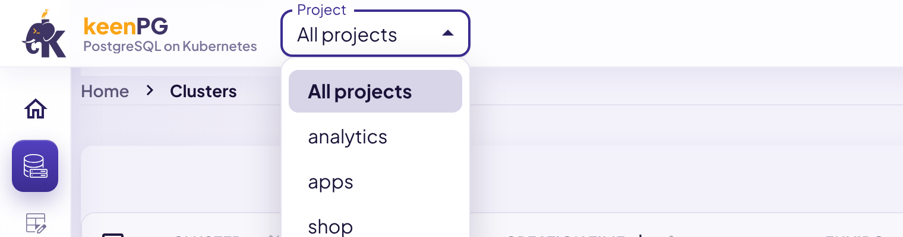

*Project list with All projects*

Like **All namespaces** in OpenShift, **All projects** is first in the list. Pick a project to see only its clusters. The lists of clusters, the SQL editor and Backup & Restore follow the project you pick.

!!! note "Your role decides what you see"

    You see only the pages and buttons your role allows. See [Users and access](#users-and-access).

## Home

The Home page is your daily check: in one look you see whether everything is fine.

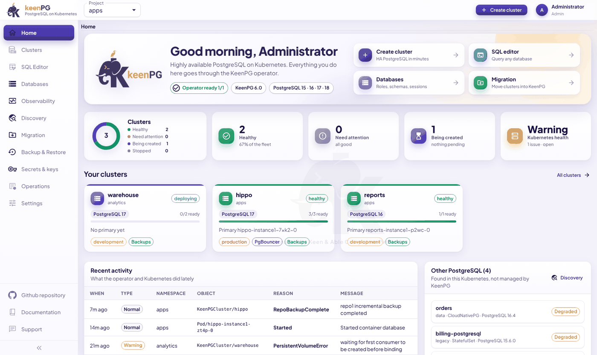

*Home page*

**Top card**

- **Operator ready 1/1** means the KeenPG operator is running.
- The chips show the **PostgreSQL versions** you can use.
- The four shortcuts open **Create cluster**, **SQL editor**, **Databases** and **Migration**.

**Count cards**

| Card | Meaning |
| :---- | :---- |
| **Clusters** ring | All clusters, split by state. |
| **Healthy** | Clusters with every pod ready. |
| **Need attention** | Clusters with a problem. Open them first. |
| **Being created** | New clusters that are still starting. |
| **Kubernetes health** | Problems in Kubernetes itself, for example a node that is not ready. |

**Your clusters**

One card per cluster. Each card shows:

- the PostgreSQL version;
- how many pods are ready (for example `3/3 ready`);
- the current primary;
- labels such as **production**, **PgBouncer** or **Backups**.

Click a card to open the cluster.

Lower on the page, **Recent activity** lists what happened lately (for example "backup completed"). **Other PostgreSQL** lists databases in your Kubernetes that KeenPG does not manage yet.

## Create a cluster

Click **Create cluster** (top right). The form has 9 numbered steps. While you fill it, the **Summary** on the right shows what you will get.

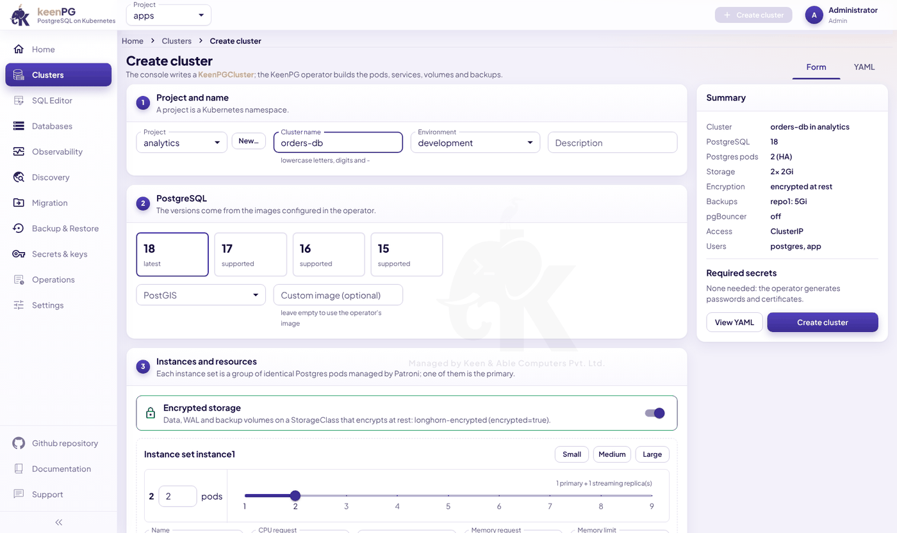

*Create cluster: project, name and version*

**Step 1: Project and name**

- **Project:** where the cluster will live. Click **New…** to make a new project.
- **Cluster name:** lowercase letters, digits and `-`, for example `orders-db`. You can't change it later.
- **Environment:** development, staging or production. This is a label that helps you sort and find clusters.
- **Description:** optional, for example "orders and payments".

**Step 2: PostgreSQL**

- Pick the **version** (15, 16, 17 or 18). Use the newest unless your application needs an older one.
- **PostGIS:** pick a version only if you store maps or locations.
- **Custom image:** leave it empty. KeenPG then uses its own tested image.

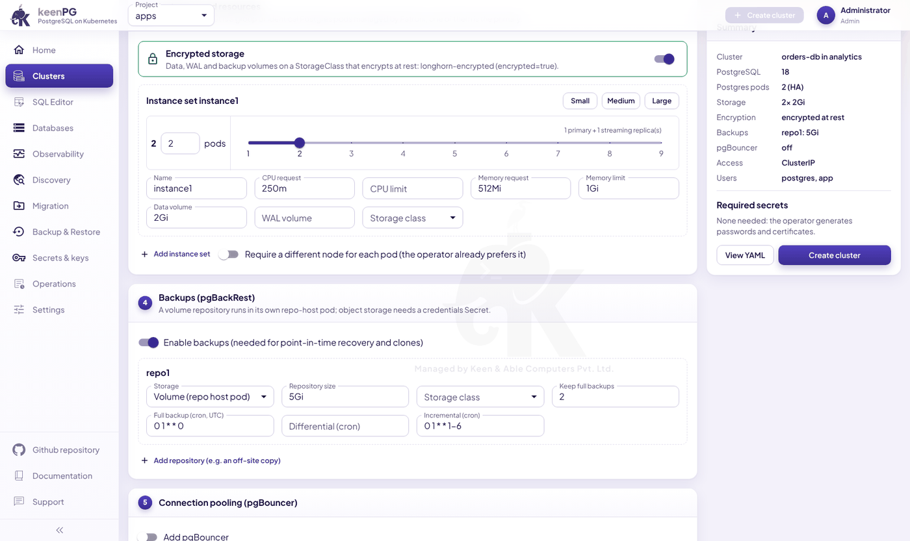

*Create cluster: pods, size and backups*

**Step 3: Instances and resources**

- **Encrypted storage** turns on by itself when your Kubernetes has encrypting disks.
- **Pods:** how many PostgreSQL servers you get.
    - `1` = a single server, with **no automatic failover**. Fine for testing.
    - `2` or more = one primary plus replicas, with **automatic failover**. **Use this for production.**
- **Size:** click a preset (table below), or type your own values.
- **Require a different node for each pod** puts each copy on a different machine, so one broken machine can't take down every copy.

| Preset | CPU | Memory | Disk |
| :---- | :---- | :---- | :---- |
| Small | 0.25 | 512 MiB | 2 GiB |
| Medium | 1 | 2 GiB | 20 GiB |
| Large | 4 | 8 GiB | 100 GiB |

**Step 4: Backups**

- Keep **Enable backups** on. Without backups you can't restore or clone.
- **Storage:** a *volume* (a disk inside Kubernetes) or *object storage* (S3, GCS, Azure). Object storage needs a credentials Secret first, from **Secrets & keys**.
- **Schedules** use cron format, in UTC. For example, `0 1 * * 0` means every Sunday at 01:00.
    - **Full:** a complete copy.
    - **Differential:** changes since the last full backup.
    - **Incremental:** changes since the last backup of any type.
- **Keep full backups:** how many full backups to keep. Older ones are removed automatically.

**Steps 5 to 9 (optional)**

| Step | What to set |
| :---- | :---- |
| **5. Connection pooling** | Turn on **pgBouncer** if your application opens many connections. |
| **6. Network, security, monitoring** | **ClusterIP** = reachable only inside Kubernetes. **NodePort / LoadBalancer** = reachable from outside. **Monitoring** and **Logging** (below). Extra image pull secrets, your own TLS certificate. |
| **7. Users and databases** | Each user gets a database and a generated password. Keep **Also create the postgres superuser Secret** on to use the SQL editor with full rights. |
| **8. PostgreSQL parameters** | Settings such as `max_connections`. Leave the defaults if you aren't sure. |
| **9. Initial data** | Start empty, or start from another cluster's backup, optionally at a point in time. |

**Step 6 details: Monitoring and logging**

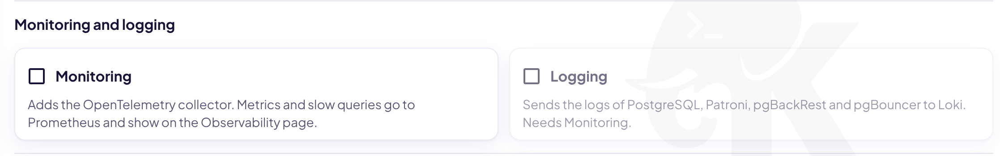

*Create cluster: Monitoring and Logging*

Both are **off** unless you tick them:

- **Monitoring** adds the collector to each pod. Metrics and slow queries go to Prometheus and show on the Grafana dashboards. It works for every PostgreSQL version. It is greyed out until monitoring is installed (`kubectl apply -k config/monitoring`).
- **Logging** also sends the logs of PostgreSQL, Patroni, pgBackRest and pgBouncer to Loki. It needs **Monitoring**. It is greyed out until Loki is installed (`kubectl apply -k config/logging`).

You can change both later. See [Monitoring and logging](#monitoring-and-logging).

**Finish**

Check the **Summary**, optionally click **View YAML** to see the exact definition, then click **Create cluster**.

The new cluster, and a new project, show up straight away; there is no need to reload the page. It shows **deploying** and is usually ready in 2 to 5 minutes. The first time can take longer, because the images are downloaded.

!!! tip "No passwords to prepare"

    The Summary shows **Required secrets: None needed**. The operator creates every password and certificate by itself.

## Clusters list

Click **Clusters** in the menu to see every cluster of the project you picked, or of all projects.

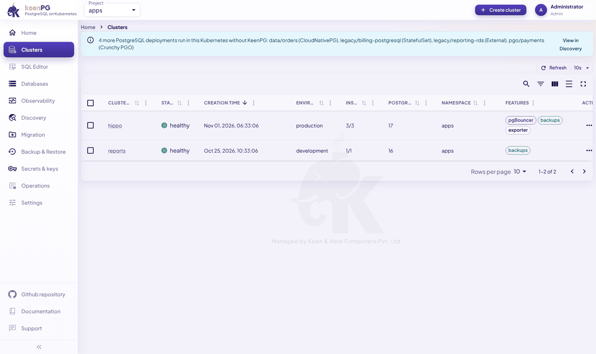

*Clusters list*

| Column | Meaning |
| :---- | :---- |
| **Cluster** | The name. Click it to open the cluster. |
| **Status** | `healthy`{ .st-ok }, `deploying`{ .st-warn }, `degraded`{ .st-bad } or `stopped`{ .st-off }. |
| **Environment** | The label you chose (development, production…). |
| **Instances** | Ready pods / total pods, for example `3/3`. |
| **PostgreSQL** | Major version. |
| **Namespace** | The project of the cluster. Useful with **All projects**. |
| **Features** | Backups, PgBouncer, **monitoring**, **logging** and so on. |

The list refreshes every 10 seconds, and every 5 seconds while a cluster is being created. Use the icons above the table to search, filter or choose columns.

## Inside a cluster

Open a cluster to see everything about it. The header shows its health, environment, project, version and current primary. The page has 8 tabs.

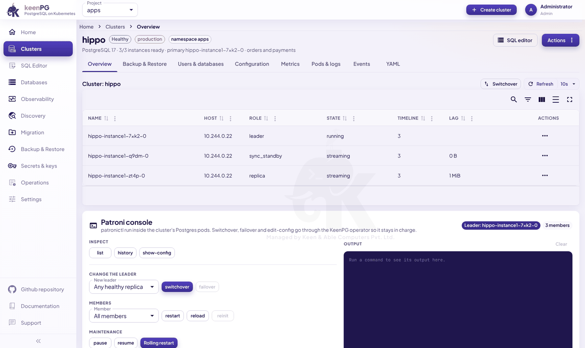

*Cluster overview*

### The tabs

| Tab | What it shows and what you can do |
| :---- | :---- |
| **Overview** | Every member with its **role** (leader, sync_standby, replica), **state** and **lag**, the Patroni console (below), services, instance sets and the **Features** card. |
| **Backup & Restore** | Backup schedules, the list of backups, and the backup jobs. See [Backup and restore](#backup-and-restore). |
| **Users & databases** | Users the operator manages, with **Connection**, **Edit**, **Add user** and remove. |
| **Configuration** | PostgreSQL parameters and extra `pg_hba` access rules. Click **Save** to apply. |
| **Metrics** | Uptime, connections, cache hit rate, replication lag, database sizes and the longest-running queries. |
| **Pods & logs** | Every pod with its status and restarts. **Logs** opens a pod's log. **Delete** recreates a stuck pod. |
| **Events** | What Kubernetes and the operator reported, newest first. **Look here first when something is wrong.** |
| **YAML** | The full cluster definition. Advanced users can edit it and click **Save**. |

### Reading the members table

- **leader** is the primary.
- **sync_standby** is a replica that has every write.
- **replica** is a normal copy.
- **State** should be `running` for the leader and `streaming` for the others.
- **Lag** of `0 B` means up to date. A large, growing lag means a replica is falling behind.

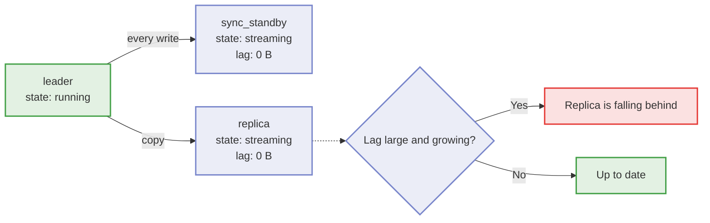

### The Patroni console

The panel under the members table runs safe Patroni commands for you. The answer appears in **Output**.

| Button | What it does |
| :---- | :---- |
| **list / history / show-config** | Show the members, past leader changes, and the current settings. |
| **switchover** | Moves the leader to a healthy replica, with a short pause in writes. |
| **failover** | Forces a new leader. **Only for emergencies**, when the leader is unhealthy. |
| **restart / reload** | Restarts a member, or reloads its settings without a restart. |
| **reinit** | Rebuilds a broken replica from scratch from the leader. |
| **pause / resume** | Turns automatic failover off and on, for planned maintenance. |
| **Rolling restart** | Restarts every member one by one, replicas first. |

### The Actions menu

Click **Actions** (top right of the cluster page).

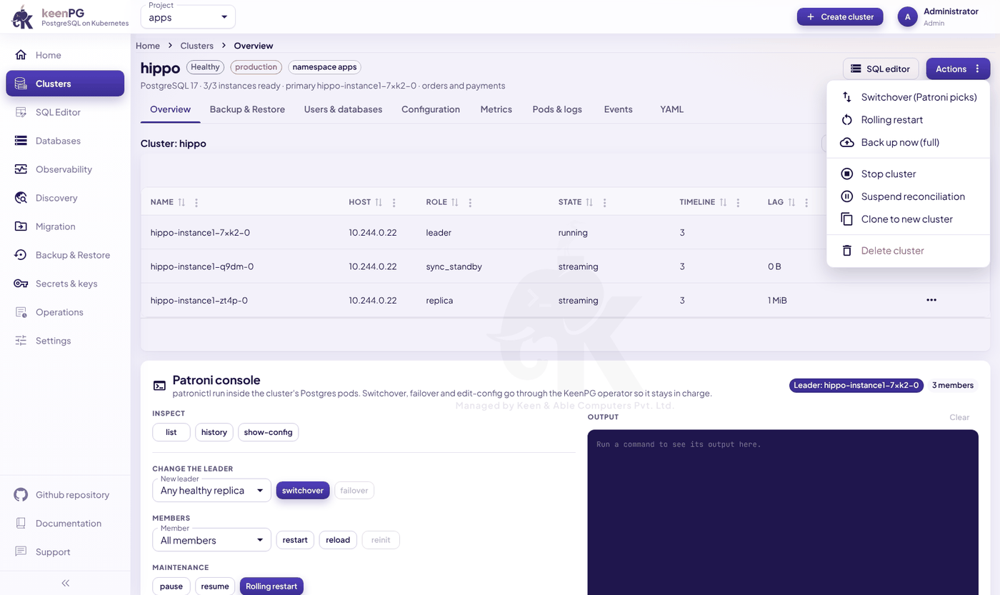

*Actions menu*

| Action | What happens |
| :---- | :---- |
| **Switchover (Patroni picks)** | Patroni moves the primary to the best replica. Applications reconnect within seconds. |
| **Rolling restart** | All pods restart one at a time, replicas first. Use it after a setting that needs a restart. |
| **Back up now (full)** | Starts a full backup immediately. |
| **Stop cluster** | Shuts down all PostgreSQL pods to save resources. **Data is kept.** **Start cluster** brings it back. |
| **Suspend reconciliation** | The operator stops managing this cluster: it neither changes nor repairs it. Use only for short maintenance. **Resume** to continue. |
| **Clone to new cluster** | Makes a new cluster from this one's backups. The original is not changed. |
| **Delete cluster** | Deletes the cluster, **its disks and the backups in its volume repositories**. You must type the name to confirm. **This can't be undone.** |

!!! danger "Delete cluster can't be undone"

    It removes the disks and the backups in the volume repositories. You must type the cluster name to confirm.

## Monitoring and logging

Turn them on or off for a running cluster on its **Overview** tab, in the **Features** card:

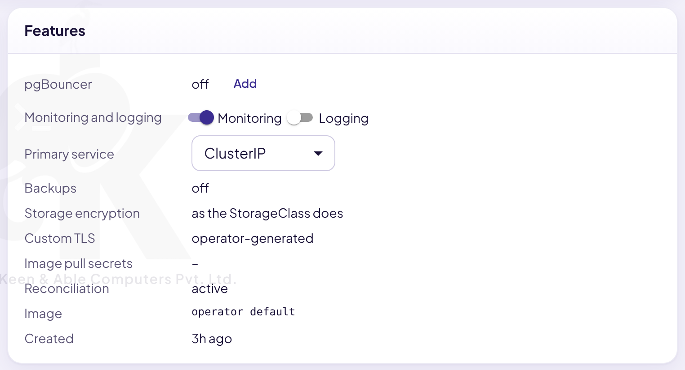

*Monitoring and Logging switches*

The console asks first and tells you what will happen:

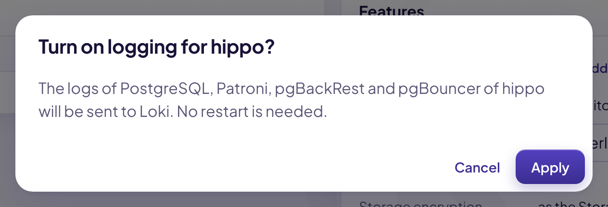

*Turn on logging*

| Change | What happens |
| :---- | :---- |
| **Monitoring on** | The collector is added to every pod, with `pg_stat_statements` for slow queries. **The PostgreSQL pods restart one by one, replicas first.** |
| **Monitoring off** | The collector is removed, and Logging goes off too. The pods restart one by one. |
| **Logging on** | Logs go to Loki. No restart is needed, except the very first time: the operator restarts once to turn on log collection, and each monitored cluster then needs one **Rolling restart** (cluster → **Actions**) before PostgreSQL writes its own log lines. |
| **Logging off** | Logs are no longer sent. Logs already in Loki stay until they expire (7 days). |

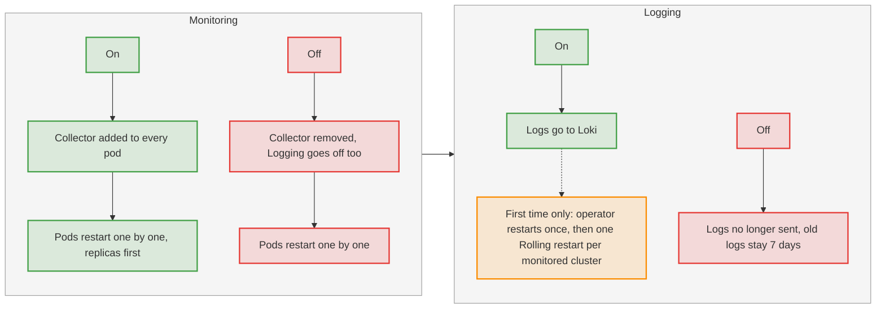

!!! warning "Using Helm with logging?"

    The console turns on the operator's `OpenTelemetryLogs` setting the first time someone ticks Logging. A later `helm upgrade` sets it back to what `values.yaml` says. Once you use logging, put both in your values:

    ```yaml title="values.yaml"
    operator:
      featureGates: "OpenTelemetryMetrics=true,OpenTelemetryLogs=true"
    ```

    If you forget, **Observability › Dashboards** shows a warning with a **Turn on again** button.

!!! note "Older clusters"

    Clusters made with the old **metrics exporter** still work. To move them to the collector, turn Monitoring off and on.

## Connect your application

Open the cluster → **Users & databases** → **Connection** next to the user.

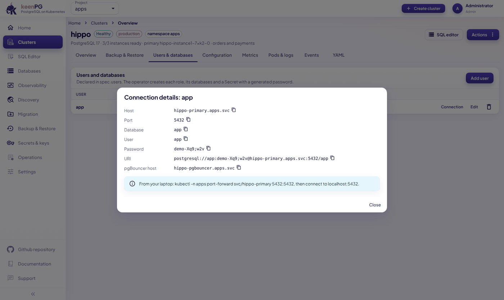

*Connection details*

The window shows everything an application needs. Click the copy icon next to any value.

| Field | Example | Use |
| :---- | :---- | :---- |
| **Host** | `hippo-primary.apps.svc` | The address of the current primary. |
| **Port** | `5432` | The PostgreSQL port. |
| **Database / User** | `app` | What to connect to, and as whom. |
| **Password** | (generated) | Also stored in the Secret `<cluster>-pguser-<user>`. |
| **URI** | `postgresql://app:…@hippo-primary.apps.svc:5432/app` | A complete connection string you can paste. |
| **pgBouncer host** | `hippo-pgbouncer.apps.svc` | Use this instead of the host when PgBouncer is on. |

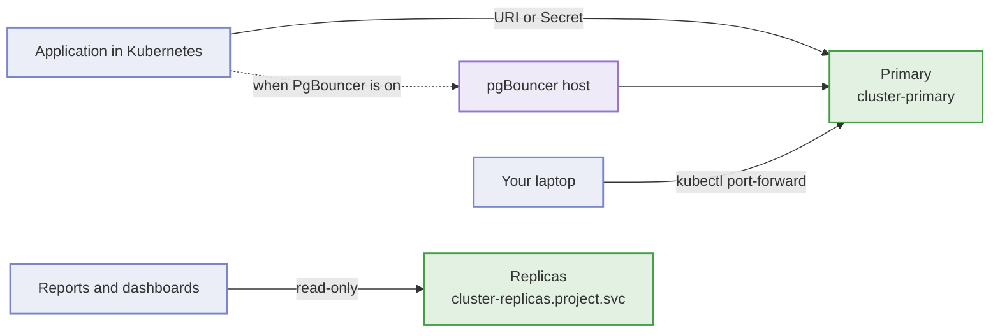

**From an application inside Kubernetes**

Use the URI as shown. You can also read it from the Secret `<cluster>-pguser-<user>`, which has the keys `host`, `port`, `user`, `password`, `dbname`, `uri` and `jdbc-uri`.

**For read-only traffic**

For reports and dashboards, use the replicas: `<cluster>-replicas.<project>.svc`, same port, user and password.

**From your laptop**

Forward the port first:

```sh title="Connect from your laptop"
kubectl -n <project> port-forward svc/<cluster>-primary 5432:5432
psql "postgresql://<user>:<password>@localhost:5432/<database>"
```

!!! tip "The primary address never changes"

    `<cluster>-primary` **always points to the current primary**, even right after a failover. Your application doesn't need to change anything.

## Backup and restore

Open **Backup & Restore** in the menu (or the cluster's **Backup & Restore** tab), and choose the cluster at the top right.

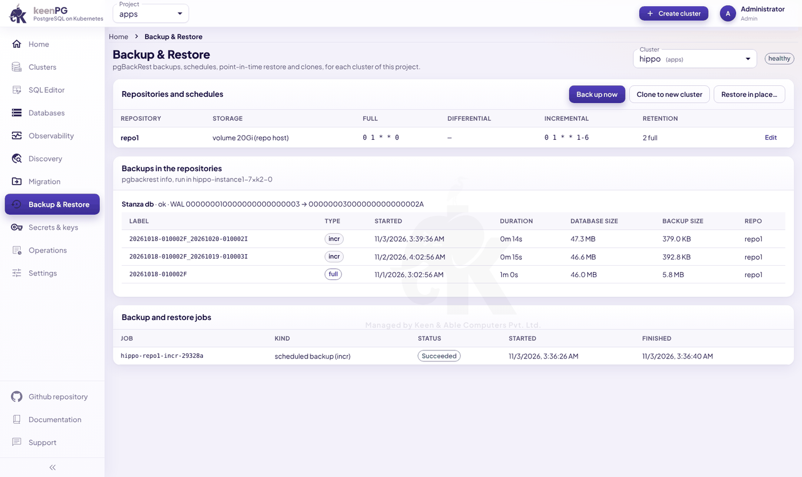

*Backup and restore*

**What the page shows**

- **Repositories and schedules:** where backups go, when each type runs, and how many are kept. Click **Edit** to change them.
- **Backups in the repositories:** every backup with its type (`full`, `diff`, `incr`), start time, duration, database size and backup size.
- **Backup and restore jobs:** each run and whether it **Succeeded**.


**Take a backup now**

Click **Back up now**. It appears under the jobs, then in the backup list when finished.
**Restore in place**

This replaces **all** data in this cluster with a backup.

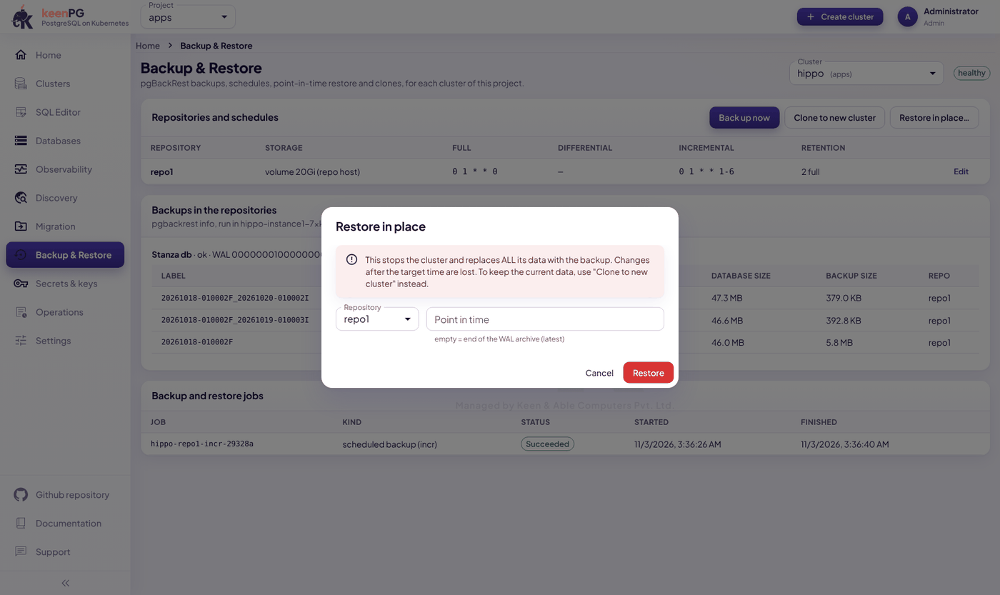

*Restore in place*

1. Click **Restore in place…**.
2. Choose the **Repository**.
3. In **Point in time**, type the moment to go back to, for example `2026-11-02 10:15:00+05:30`. Leave it empty to restore to the latest point possible.
4. Click **Restore**. The cluster stops, restores and starts again. Changes made after that moment are lost.

!!! warning "Restore in place replaces all data"

    Changes made after the chosen moment are lost. When in doubt, use **Clone to new cluster** instead.

**Clone to new cluster**

This is the safe choice. The Create cluster form opens, already filled in, with the backup as its initial data. Pick a name and, if needed, a point in time, then click **Create cluster**. The original cluster is not touched.

Use a clone to:

- get back a table deleted by mistake: clone to just before the mistake, then copy the table back;
- test an upgrade or a risky change;
- give developers a copy of production.

## SQL Editor

Run SQL on any database straight from your browser, on the **primary** or on a **replica**.

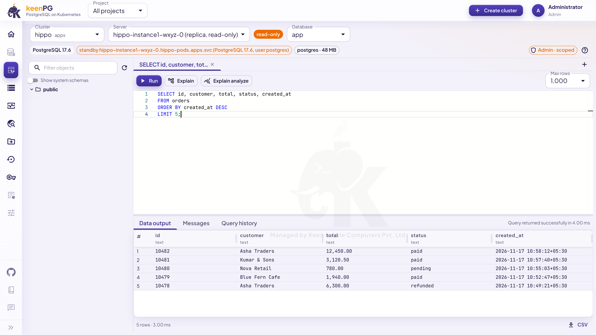

*SQL editor on a replica*

**Run a query**

1. Choose the **Cluster**, the **Server** and the **Database** at the top.
2. Type your SQL. The left panel lists schemas, tables and views; click one to use its name.
3. Click **Run**, or press ++f5++ or ++ctrl+enter++. To run only part of the text, select it first.
4. Results appear in **Data output**. Click **CSV** (bottom right) to download them.

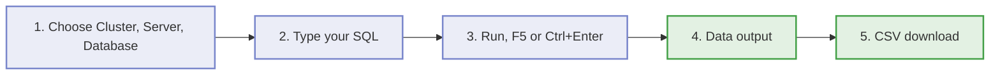

**Choose the server**

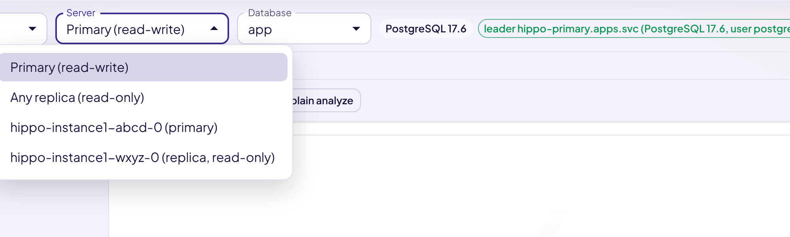

*Server list*

| Server | Use it for |
| :---- | :---- |
| **Primary (read-write)** | The default. Everything, including changes. |
| **Any replica (read-only)** | Reports and heavy reads, to keep load off the primary. The replicas share the work. |
| **One instance**, for example `hippo-instance1-wxyz-0 (replica, read-only)` | Checking one exact server, for example whether a replica has the latest data. |

On a replica an orange **read-only** label shows. Replicas are live copies, so queries that change data are refused there. The chip under the cluster tells you which server answered (**leader** or **standby** and its address).

**More tools**

- **Explain** and **Explain analyze** show how PostgreSQL runs a query, to help you make it faster.
- **Messages** shows notices and errors. **Query history** shows what you ran before.
- **+** opens another query tab. **Max rows** limits how many rows come back.
- The badge at the top right shows your access, for example **Admin · scoped**. Read-only users can only run queries that don't change data.
- With **All projects**, the cluster list shows each cluster's project next to its name.

!!! note "Audit log"

    **Every query that can change data is recorded in the audit log.**

## Databases

The **Database manager** lets you manage what is *inside* a cluster without writing SQL. Choose the **Cluster** and **Database** at the top right.

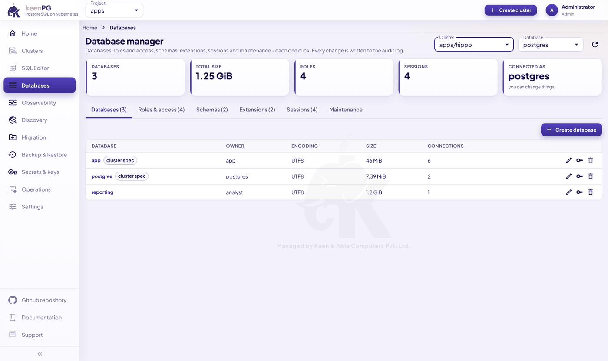

*Database manager*

The cards show the number of databases, total size, roles, open sessions, and which user the page is connected as.

| Tab | What you can do |
| :---- | :---- |
| **Databases** | Create, rename, change owner, drop. |
| **Roles & access** | Create users and groups, set passwords and expiry dates, and grant access per schema (connect / read / write / all). |
| **Schemas** | Create and drop schemas. |
| **Extensions** | Install, update or remove extensions such as `pg_stat_statements`. |
| **Sessions** | See who is connected and what they run. Cancel a query, or disconnect a session. |
| **Maintenance** | Run **VACUUM**, **ANALYZE**, **VACUUM FULL** or **REINDEX**, and see the largest tables with their dead rows. |

!!! note "Items marked cluster spec"

    These were created in the Create cluster form and are managed by the operator. Change those on the cluster's **Users & databases** tab instead.

## Observability

**Observability** in the left menu opens two pages: **Dashboards** and **Kubernetes**.

### Dashboards

The Grafana dashboards of every cluster, **inside the console**. You don't sign in to Grafana separately: the console signs you in. Console admins are Grafana admins; everyone else can look but not change dashboards.

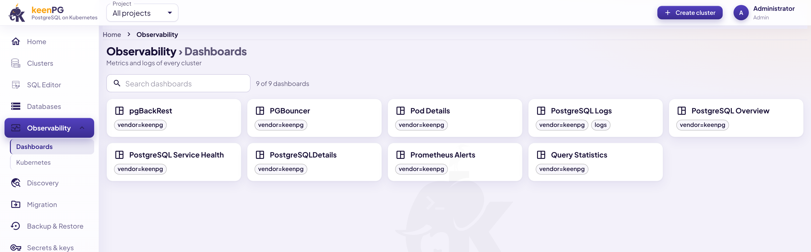

*Dashboards*

1. Open **Observability › Dashboards**. Type in **Search dashboards** to find one.
2. Click a dashboard. It opens on the same page, with Grafana's own time range and filters.
3. **All dashboards** goes back to the list; **Open in a new tab** opens it on its own.

| Dashboard | What it shows |
| :---- | :---- |
| **PostgreSQL Overview** | All clusters at a glance. |
| **PostgreSQL Details** | One cluster in depth: connections, transactions, cache, locks, replication. |
| **PostgreSQL Service Health** | Saturation, errors and availability. |
| **Query Statistics** | The slowest and busiest queries (`pg_stat_statements`). |
| **pgBackRest** | Backups and WAL archiving. |
| **PGBouncer** | Pools, client and server connections. |
| **Pod Details** | CPU, memory, disk and network of each pod. |
| **Prometheus Alerts** | Alerts that are firing. |
| **PostgreSQL Logs** | The logs, coloured by level (with Logging on). |

!!! info "Requirements"

    The dashboards need monitoring installed (`kubectl apply -k config/monitoring`) and **Monitoring** on for the clusters you want to see. Users limited to some projects can't open this page, because the dashboards show every cluster.

??? note "Open Grafana on its own"

    Grafana lives under `/grafana/`:

    ```sh
    kubectl -n keenpg-operator port-forward svc/keenpg-grafana 3000:3000     # then http://localhost:3000/grafana/
    ```

### Kubernetes

The health of the Kubernetes nodes and system pods under your databases.

## Discovery

Discovery finds **other PostgreSQL databases** already running in your Kubernetes that KeenPG doesn't manage.

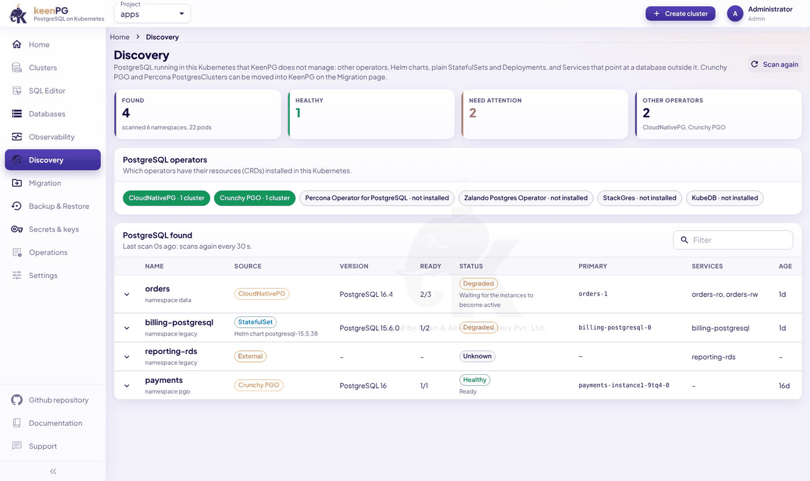

*Discovery*

- **Top cards:** how many databases were found, and how many are healthy or need attention.
- **PostgreSQL operators:** which other operators are installed: CloudNativePG, Crunchy PGO, Percona, Zalando, StackGres, KubeDB.
- **PostgreSQL found:** each database with its source (an operator, a Helm chart, a plain StatefulSet, or an external service), version, ready pods, status, primary and services. Click the arrow for details.

Discovery scans again every 30 seconds. **Crunchy PGO** and **Percona** databases can be moved into KeenPG on the **Migration** page.

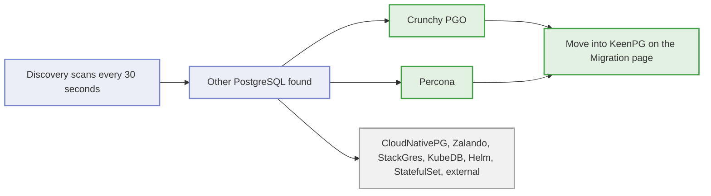

## Migration

Move databases from **Crunchy PGO** or **Percona** into KeenPG. KeenPG reads the source's own backups, so **the source database is never changed or stopped**.

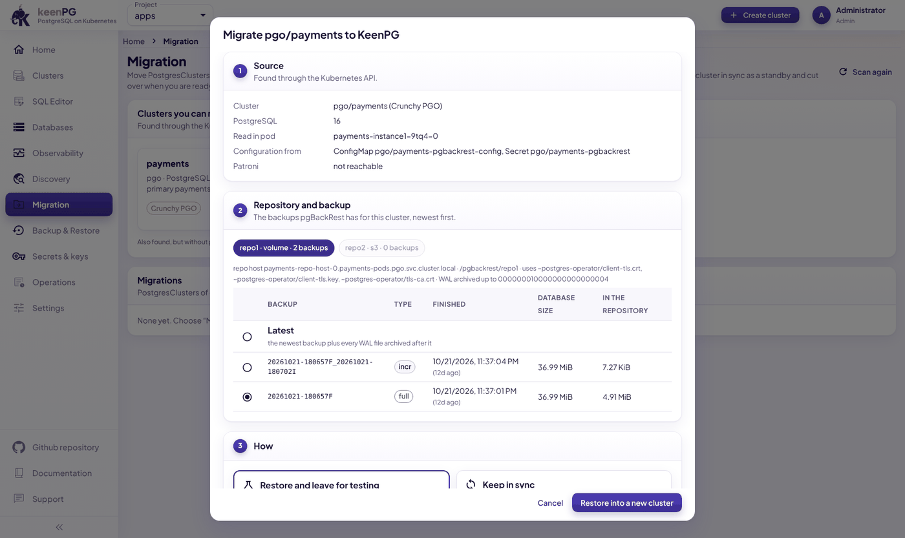

*Migration*

1. Open **Migration** and click **Migrate** on the cluster you want to move.
2. **Source:** check the details (cluster, version, pod).
3. **Repository and backup:** choose where to read backups from, and which backup. **Latest** means the newest backup plus every change after it.
4. **How:**
    - **Restore and leave for testing:** builds a new KeenPG cluster from the backup. The source keeps running. Use this to test first.
    - **Keep in sync:** the new cluster follows the source and keeps copying its changes. When you are ready to switch, click **Cut over**, and the new cluster becomes a normal primary.
5. Click **Restore into a new cluster**. Progress appears under **Migrations**.

The new cluster has the same PostgreSQL major version as the source.

## Users and access

**Settings → Users** lists everyone who can sign in to the console.

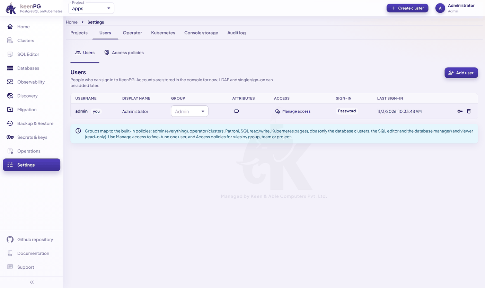

*Users*

- **Add user:** create an account.
- **Group:** decides what the person can do (table below).
- **Manage access:** fine-tune one person. Allow or deny single permissions, or limit them to some projects.
- **Key icon:** reset the person's password. **Trash icon:** remove the person.

| Group | Can do |
| :---- | :---- |
| **Admin** | Everything: users, access policies, settings, audit log, SQL as superuser, Grafana admin. |
| **Operator** | Create and run clusters, Patroni actions, backups, Secrets, Kubernetes pages, discovery and migration, SQL read/write. |
| **DBA** | Only the database clusters, the SQL editor (as superuser) and the database manager. No Kubernetes pages, Secrets or settings. |
| **Viewer** | Read only. |

The **Access policies** tab holds rules for groups, teams or single users, optionally limited to some projects, clusters or databases. **Deny wins over allow.** The Administrators policy can't be changed, so an admin can never lock themselves out.

## Other pages

| Page | What it is for |
| :---- | :---- |
| **Secrets & keys** | Create what some features need *before* you create a cluster: a **registry login** for private images, **S3 / GCS / Azure credentials** for backups, or a **TLS key pair**. Database passwords are not made here; the operator creates them. |
| **Operations** | All backup and restore jobs, and all events, for every cluster, in one list. **Warning** lines need attention. |
| **Settings → Projects** | The projects (namespaces) KeenPG uses. **Add project** makes a new one. |
| **Settings → Operator** | The operator's state and the image used for each PostgreSQL version and tool. |
| **Settings → Kubernetes** | Storage classes (disk types, and whether they can grow) and the nodes. |
| **Settings → Console storage** | The console's own small database (users, sessions, audit log) and its disk. Click **Increase size** if it fills up. |
| **Settings → Audit log** | Every change and every SQL query that changes data: when, who, what. Kept for 180 days by default. |

## Upgrade the console

```sh title="Upgrade the console"
helm upgrade keenpg ./keenpg-operator -n keenpg-operator --reuse-values
kubectl -n keenpg-operator rollout status deploy/keenpgo-console
```

Then reload the browser with ++ctrl+shift+r++, so it doesn't keep the old page.

- Your users, settings, audit log, the admin password and the HTTPS certificate are kept.
- If the image keeps the same tag (for example `v6.0`), make Kubernetes download it again: set the console's image pull policy to `Always` in your values, or run `kubectl -n keenpg-operator rollout restart deploy/keenpgo-console`.
- Using logging? Make sure `operator.featureGates` still says `OpenTelemetryMetrics=true,OpenTelemetryLogs=true`.

## Common tasks

| I want to… | Do this |
| :---- | :---- |
| Get the admin password | `kubectl -n keenpg-operator get secret keenpgo-console-admin -o jsonpath='{.data.password}' | base64 -d` (see [Sign in](#sign-in)) |
| See the clusters of every project | **Project** (top left) → **All projects**. |
| Create a database for a new app | **Create cluster** → fill steps 1–7 → **Create cluster**. |
| Get my app's connection details | Cluster → **Users & databases** → **Connection**. |
| Run a report without loading the primary | **SQL Editor** → **Server** → **Any replica (read-only)**. |
| Back up before a risky change | Cluster → **Actions** → **Back up now (full)**. |
| Recover data deleted by mistake | **Backup & Restore** → **Clone to new cluster** → a time just before the mistake → copy the data back. |
| Add a replica | Cluster → **YAML** → raise `replicas` under `instances` → **Save**. |
| Change a PostgreSQL setting | Cluster → **Configuration** → change → **Save**. |
| Move the primary before maintenance | Cluster → **Actions** → **Switchover**. |
| Pause a test database to save resources | Cluster → **Actions** → **Stop cluster** (data is kept). |
| Turn on metrics or logs for a cluster | Cluster → **Overview** → **Features** → **Monitoring** / **Logging**. |
| See the dashboards | **Observability** → **Dashboards** → click a dashboard. |
| Find slow queries | **Observability** → **Dashboards** → **Query Statistics**, or cluster → **Metrics**. |
| Read a cluster's logs | **Observability** → **Dashboards** → **PostgreSQL Logs** (Logging on). |
| Find out why a cluster isn't healthy | Cluster → **Events**, then **Pods & logs**. |
| Give a colleague read-only access | **Settings → Users** → **Add user** → group **Viewer**. |
| See who changed something | **Settings → Audit log**. |

## Troubleshooting

Start here when something is wrong:

| What you see | What it means | What to do |
| :---- | :---- | :---- |
| Pods show **ImagePullBackOff** or **401 Unauthorized** | Kubernetes can't download the images. | The registry login is missing or wrong. Run `helm upgrade` with `pullSecret.create=true` and your `auth.json`, then delete the stuck pods. |
| **manifest unknown** / **not found** | That image version doesn't exist in the registry. | Contact KeenPG support. |
| The browser says **"Your connection is not private"** | The console's certificate is self-signed. | Expected. Click **Advanced → Continue**, or trust the certificate (see [HTTPS](#https-and-the-certificate)). |
| **"Wrong username or password"** for `admin` | The password is not `admin`: Helm made a random one. | Read it from the Secret `keenpgo-console-admin` (see [Sign in](#sign-in)). Still wrong? Reset the admin as shown there. |
| Console log: **password authentication failed for user "keenpgo"** | The Secret `keenpgo-console-db` no longer matches the console database (for example it was deleted and made again). | Put the old password back into the Secret, or give the database the new one. Ask KeenPG support for the exact commands for your case. |
| A pod stays **Pending**, or a **PersistentVolumeError** event | No disk could be created. | Check **Settings → Kubernetes** for a storage class with free space. |
| A **MissingRequiredImage** event | No image is set for that PostgreSQL version. | Choose a version offered in the Create cluster form. |
| The cluster stays **deploying** | Something is blocking the start. | Read the cluster's **Events** tab, then **Pods & logs**. |
| A replica's lag keeps growing | The replica is falling behind or stuck. | Overview → Patroni console → choose the member → **reinit**. |
| **Monitoring** or **Logging** is greyed out | Prometheus or Loki is not installed. | `kubectl apply -k config/monitoring` (and `config/logging` for logs). |
| **Dashboards:** "The dashboards are not available" | Grafana is not installed or not reachable. | `kubectl apply -k config/monitoring`. If Grafana runs elsewhere, set `KEENPGO_GRAFANA_URL` on the console. |
| **Dashboards:** a panel says **origin not allowed** | A proxy in front of the console changes the address. | `kubectl -n keenpg-operator set env deploy/keenpgo-grafana GF_SECURITY_CSRF_TRUSTED_ORIGINS=<your console address>` |
| **Dashboards:** "the operator has log collection turned off" | A `helm upgrade` removed the logging setting. | Click **Turn on again**, and add `OpenTelemetryLogs=true` to `operator.featureGates` in your values. |
| Logging is on, but no **PostgreSQL** log lines (Patroni lines arrive) | PostgreSQL has not restarted since log collection was turned on. | Cluster → **Actions** → **Rolling restart**. |
| SQL editor: **"cannot execute … in a read-only transaction"** | You ran a change on a replica. | Pick **Primary (read-write)** in **Server**. |
| "No console database is configured" | The console's own database isn't running. | Check the pod `keenpgo-console-db-0` in the `keenpg-operator` project. |

**Still stuck?**

Send this output to KeenPG support:

```sh title="Collect support information"
kubectl -n <project> get keenpgcluster <cluster> -o yaml
kubectl -n <project> get pods,pvc,events
kubectl -n keenpg-operator logs deploy/keenpgo --tail=200
kubectl -n keenpg-operator logs deploy/keenpgo-console --tail=200
```

## Be careful

!!! danger "Read these before you change anything in production"

    - **Deleting a cluster is permanent.** It removes the cluster's disks and the backups in its volume repositories. Keep important backups in object storage too, or clone before you delete.
    - **Restore in place replaces all data.** When in doubt, use **Clone to new cluster**.
    - **Use 2 or more pods for production.** With one pod there is no automatic failover.
    - **Keep backups on.** Without them you can't restore or clone.
    - **Change the admin password** on the first day, and never share it in chats or tickets.
    - **Turning Monitoring on or off restarts the PostgreSQL pods** one by one. Do it in a quiet hour for busy production databases.
    - **Suspend reconciliation only for short maintenance.** While suspended, the operator doesn't repair the cluster.
    - **Don't delete the Secrets `keenpgo-console-db` or `keenpgo-console-admin`.** The console database keeps its first password; a new Secret won't match it.