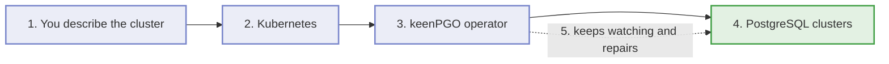

# keenPGO documentation

**keenPGO** is the keenPG operator for Kubernetes. It runs PostgreSQL clusters for you: creating them, scaling them, healing them after failures, and taking care of backups, so your team can focus on applications instead of database upkeep.

With keenPGO you describe the cluster you want, and the operator makes it happen and keeps it that way. Every cluster is built the same way, which means fewer surprises between development, staging and production.

[:material-rocket-launch: Start with the Quickstart](quickstart.md){ .md-button .md-button--primary }
[:material-monitor-dashboard: Explore the Console](console.md){ .md-button }

!!! note ""

    You are reading the documentation for keenPGO version **<version>**.
    See the [release notes](release-notes/index.md) for what has changed.

## What keenPGO does for you

-   :material-database-plus:{ .lg .middle } __Create__

    ---

    Describe the cluster you want. The operator builds the pods, disks, services, users, passwords and certificates.

-   :material-arrow-expand-all:{ .lg .middle } __Scale__

    ---

    Add replicas when you need more capacity or better availability.

-   :material-heart-pulse:{ .lg .middle } __Heal__

    ---

    If a pod crashes or a disk is lost, the operator puts it back. A replica takes over automatically if the primary fails.

-   :material-backup-restore:{ .lg .middle } __Back up__

    ---

    Schedule backups, restore to a point in time, or clone a cluster without touching the original.

## How it works

You describe the cluster once. The operator builds it and then keeps watching, so the cluster always matches what you asked for.

!!! tip "Same result everywhere"

    Every cluster is built the same way, so development, staging and production behave alike.

## Where to go next

-   :material-clock-fast:{ .lg .middle } __Quickstart__

    ---

    Go from an empty Kubernetes cluster to a running PostgreSQL database in about ten minutes.

    [:octicons-arrow-right-24: Quickstart](quickstart.md)

-   :material-monitor-dashboard:{ .lg .middle } __Guide to Console__

    ---

    A step-by-step guide to every part of the KeenPG console: create, connect, back up and monitor your databases.

    [:octicons-arrow-right-24: Console](console.md)

-   :material-chart-line:{ .lg .middle } __Monitoring__

    ---

    Watch every database on Grafana dashboards.

    [:octicons-arrow-right-24: Monitoring](monitoring.md)

-   :material-text-box-search-outline:{ .lg .middle } __Logging__

    ---

    Collect and read the logs of PostgreSQL and the tools around it.

    [:octicons-arrow-right-24: Logging](logging.md)

-   :material-star-four-points-outline:{ .lg .middle } __Features__

    ---

    See everything keenPGO can do.

    [:octicons-arrow-right-24: Features](features.md)

-   :material-new-box:{ .lg .middle } __Release notes__

    ---

    See what has changed in this version.

    [:octicons-arrow-right-24: Release notes](release-notes/index.md)

## Need help?

Questions about keenPGO, or want hands-on support from our engineers?

-   :material-web:{ .lg .middle } __Visit keenpg.in__

    ---

    Find out more about keenPG and keenPGO.

    [:octicons-arrow-right-24: keenpg.in](https://keenpg.in/)

-   :material-calendar-check:{ .lg .middle } __Book a demo__

    ---

    Talk to our engineers and get hands-on support.

    [:octicons-arrow-right-24: Book a demo](https://keenpg.in/contact?intent=expert)

