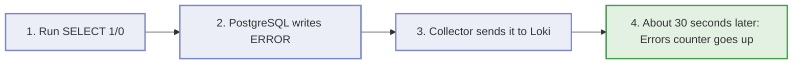

# Logging with Loki

This section shows how to collect the logs of your KeenPG clusters and see them in Grafana.

KeenPG collects the logs of **PostgreSQL**, **Patroni**, **pgBackRest** and **pgBouncer**.
The OpenTelemetry collector in each pod sends them to **Loki**. Loki stores them, and
**Grafana** shows them.

One Loki stores the logs of **all clusters in all namespaces**. You install it only once.


## How it works


1. PostgreSQL, Patroni, pgBackRest and pgBouncer write their log files in the pod.
2. The OpenTelemetry collector (a sidecar in the same pod) reads these files.
3. The collector sends the logs to Loki.
4. You search and read the logs in Grafana.

Loki keeps the logs for **7 days**. Old logs are deleted automatically.

## Before you start

- KeenPG operator is installed.
- Monitoring (Prometheus and Grafana) is installed. Grafana comes from there:

```
# kubectl apply -k config/monitoring
```

## Step 1: Enable the feature gates

The collector needs the `OpenTelemetryMetrics` and `OpenTelemetryLogs` feature gates in your `keenpgo` installation.

**Check them**

```sh title="Check the feature gates"
kubectl -n keenpg-operator get deploy keenpgo -o jsonpath='{.spec.template.spec.containers[0].env[?(@.name=="KEENPG_FEATURE_GATES")].value}'
```

```text title="Expected output"
OpenTelemetryMetrics=true,OpenTelemetryLogs=true
```

**If they are not set, turn them on**

=== "kubectl"

    ```sh title="Enable the feature gates"
    kubectl -n keenpg-operator set env deploy/keenpgo KEENPG_FEATURE_GATES="OpenTelemetryMetrics=true,OpenTelemetryLogs=true"
    ```

=== "Helm"

    If you install keenpgo with Helm, set it in `values.yaml` instead, so a later upgrade does not remove it:

    ```yaml title="values.yaml"
    featureGates: "OpenTelemetryMetrics=true,OpenTelemetryLogs=true"
    ```

!!! warning "Using Helm? Do not skip the values file"

    A command like `kubectl set env` is reset by the next `helm upgrade`. Put the feature gates in `values.yaml` to keep them.

## Step 2: Install Loki

```sh title="Install Loki"
kubectl apply -k config/logging
```

This installs Loki, the Loki data source for Grafana and the **PostgreSQL Logs** dashboard. Loki is deployed in the `keenpg-operator` namespace.

Restart Grafana, so it loads the new data source:

```sh title="Restart Grafana"
kubectl -n keenpg-operator rollout restart deploy/keenpg-grafana
```

**Check the pods**

```sh title=""
kubectl get pods -n keenpg-operator
```

```text title="Expected output"
NAME                                   READY   STATUS    RESTARTS   AGE
keenpg-alertmanager-8468ff65f6-lvp4l   1/1     Running   0          10m
keenpg-grafana-66949c8b4c-f8pxk        1/1     Running   0          1m
keenpg-loki-59769bf5d6-6nh5g           1/1     Running   0          2m
keenpg-prometheus-5c5c69549c-29j76     1/1     Running   0          10m
keenpgo-7b8d8dcc4f-tjnht               1/1     Running   0          15m
```

```sh title="Check the Loki service"
kubectl get svc keenpg-loki -n keenpg-operator
```

```text title="Expected output"
NAME          TYPE        CLUSTER-IP      EXTERNAL-IP   PORT(S)    AGE
keenpg-loki   ClusterIP   10.104.82.51    <none>        3100/TCP   2m
```

## Step 3: Send the logs of a cluster to Loki

Add an `instrumentation` block to the spec of your `KeenPGCluster`, or patch a running cluster.

=== "Edit the spec"

    ```yaml title="KeenPGCluster spec"
    spec:
      instrumentation:
        config:
          exporters:
            otlphttp/loki:
              endpoint: http://keenpg-loki.keenpg-operator.svc:3100/otlp
        logs:
          exporters: [otlphttp/loki]
          retentionPeriod: 1d
    ```

=== "Patch a running cluster"

    ```sh title="Patch the cluster"
    kubectl -n test patch keenpgcluster keenpg-ha --type merge -p '{"spec":{"instrumentation":{"config":{"exporters":{"otlphttp/loki":{"endpoint":"http://keenpg-loki.keenpg-operator.svc:3100/otlp"}}},"logs":{"exporters":["otlphttp/loki"],"retentionPeriod":"1d"}}}}'
    ```

| Setting | Meaning |
| :---- | :---- |
| `endpoint` | The address of Loki. If Loki runs in another namespace, change `keenpg-operator`. |
| `retentionPeriod` | How long the log files stay **inside the pod**. Loki keeps its own copy for 7 days. |

**Check the collector**

You will see a `collector` sidecar in the PostgreSQL, pgBouncer and repo host pods. The READY column shows one more container than before:

```sh title="List the pods of the cluster"
kubectl get pods -n test
```

```text title="Expected output"
NAME                                   READY   STATUS    RESTARTS   AGE
keenpg-ha-pgbouncer-658994757d-8jsww   3/3     Running   0          5m
keenpg-ha-pgha1-64kd-0                 5/5     Running   0          5m
keenpg-ha-pgha1-fqp6-0                 5/5     Running   0          5m
keenpg-ha-repo-host-0                  3/3     Running   0          5m
```

## Step 4 (optional): Choose what PostgreSQL logs

By default PostgreSQL logs errors, warnings and important events. To also log slow queries and other useful events, add these settings to your spec:

```yaml title="KeenPGCluster spec"
spec:
  config:
    parameters:
      log_min_duration_statement: "1000"   # queries slower than 1 second
      log_min_error_statement: error       # the query that caused an error
      log_lock_waits: "on"                 # queries waiting for a lock
      log_temp_files: "10MB"               # queries using a lot of temporary disk
      log_autovacuum_min_duration: "10s"   # slow autovacuum runs
      log_statement: ddl                   # CREATE, ALTER and DROP statements
```

!!! success "No restart needed"

    These settings do not restart PostgreSQL.

!!! danger "Never log every query in production"

    Do not use `log_statement: all` or `log_min_duration_statement: "0"` in production. They log every query and create a huge amount of logs.

## Step 5: See the logs in Grafana

!!! tip "The easy way"

    In the console, open **Observability › Dashboards** and click **PostgreSQL Logs**. The console signs you in to Grafana for you.

To open Grafana on its own, forward its port:

```sh title="Open Grafana"
kubectl -n keenpg-operator port-forward svc/keenpg-grafana 3000:3000
```

Go to `http://localhost:3000` and log in (default `admin` / `admin`).

!!! warning "Change the default Grafana password"

    `admin` / `admin` is only for a first look. Change it when Grafana asks you to.

Go to **Dashboards**. You will see the **PostgreSQL Logs** dashboard with the `logs` tag:


*Dashboards list*

Open **PostgreSQL Logs**:


*PostgreSQL Logs dashboard*

**What the dashboard shows**

| Part | What it shows |
| :---- | :---- |
| **Counters** | Fatal, errors, warnings, slow queries, backup problems and all log lines. |
| **Log lines by level** | How many lines each level wrote over time. |
| **Problems** | Fatal, errors and warnings from every component. |
| **PostgreSQL** | All PostgreSQL logs, the slowest statements and slow queries. |
| **Patroni** | Leader changes, replicas and failover. |
| **pgBackRest** | Backups and WAL archiving. |
| **pgBouncer** | Connections and pool statistics. |

**Colours**

| Colour | Level |
| :---- | :---- |
| **Purple** | `fatal` |
| **Red** | `error` |
| **Yellow** | `warning` |
| **Green** | normal |

**Filter the logs**

Use the filters at the top to choose a **Namespace**, **Pod** and **Level**, or type text in **Search**.

Click a log line to see all its details: namespace, pod, container, level and the original log line.


*Details of a log line*

Scroll down to see the logs of each component in its own section:


*Patroni, pgBackRest and pgBouncer logs*

### Search with Explore

You can also search the logs yourself in **Explore**:

1. Open **Explore** in Grafana.
2. Choose the **LOKI** data source.
3. Switch to **Code**.
4. Type a query and click **Run query**.

```text title="Useful queries"
{k8s_namespace_name="test"}                                   # all logs of a namespace
{k8s_namespace_name="test"} |= "ERROR"                        # only lines with ERROR
{k8s_pod_name=~"keenpg-ha-pgha1-.*"} |= "duration:"           # slow queries of a cluster
{k8s_container_name="pgbouncer"}                              # pgBouncer logs
```

## Check that it works

Create a test error in PostgreSQL:

```sh title="Create a test error"
kubectl -n test exec keenpg-ha-pgha1-64kd-0 -c database -- psql -c "SELECT 1/0"
```

```text title="Expected output"
ERROR:  division by zero
```

After about 30 seconds, the error shows in the **Errors** counter and in the **Problems** panel.



**No logs?** Check these three things in order:

=== "1. The collector"

    Read the log of the collector in the pod:

    ```sh
    kubectl -n test logs keenpg-ha-pgha1-64kd-0 -c collector --tail=20
    ```

=== "2. Loki"

    Check that Loki receives logs. The output must list your namespaces:

    ```sh
    kubectl -n keenpg-operator port-forward svc/keenpg-loki 3100:3100 &
    curl -s localhost:3100/loki/api/v1/label/k8s_namespace_name/values
    ```

    ```text title="Expected output"
    {"status":"success","data":["test"]}
    ```

=== "3. Grafana"

    Make sure the time range in Grafana is **Last 1 hour** or more.

## Change how long logs are kept

Loki keeps logs for 7 days (`168h`). To change it, edit `config/logging/loki/config/loki.yaml`:

```yaml title="config/logging/loki/config/loki.yaml"
limits_config:
  retention_period: 336h   # 14 days
```

Then apply it and restart Loki:

```sh title="Apply and restart"
kubectl apply -k config/logging
kubectl -n keenpg-operator rollout restart deploy/keenpg-loki
```

!!! info "Disk size"

    Loki stores the logs on a **10Gi** volume. For more days or more clusters, increase the size in `config/logging/loki/pvc.yaml`.

## Remove logging

```sh title="Remove Loki"
kubectl delete -k config/logging
kubectl -n keenpg-operator rollout restart deploy/keenpg-grafana
```

Then remove the `instrumentation.logs` block from your clusters too.

!!! danger "This deletes the stored logs"

    Removing Loki also deletes all the logs it has stored. This can't be undone.

