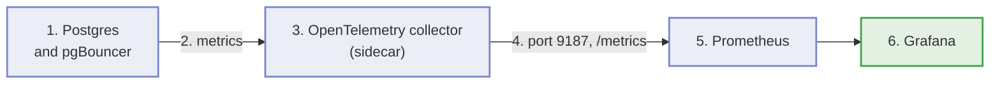
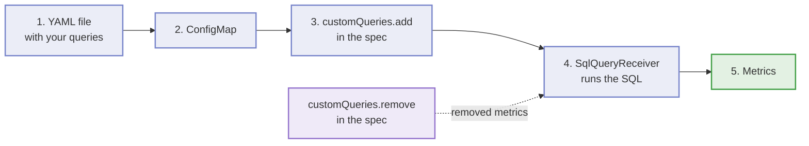
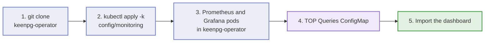

# OpenTelemetry Metrics

For an overview of the full observability architecture within keenpg.This section will provide steps for enabling OpenTelemetry metrics.

## Contents

<div class="grid cards" markdown>

-   :material-chart-line:{ .lg .middle } __Enabling OpenTelemetry Metrics__

    ---

    - [Enabling OpenTelemetry Metrics](#enabling-opentelemetry-metrics)

-   :material-database-cog:{ .lg .middle } __Customizing Postgres Queries__

    ---

    - [Customizing Postgres Queries](#customizing-postgres-queries)
    - [Adding Custom Metrics](#adding-custom-metrics)
    - [Removing Built-in Metrics](#removing-built-in-metrics)

-   :material-monitor-dashboard:{ .lg .middle } __Prometheus and Grafana__

    ---

    - [How to install Prometheus and Grafana](#how-to-install-prometheus-and-grafana)
    - [Additional TOP Queries Dashboard](#additional-top-queries-dashboard)

</div>

## Enabling OpenTelemetry Metrics



In order to use OpenTelemetry metrics, the `OpenTelemetryMetrics` feature gate must first be enabled in your keenpgo installation (by default it is enabled). 

Once the feature gate is enabled, you will be able to create KeenPostgresClusters with OpenTelemetry metrics. To do that, add an `instrumentation` block to your PostgresCluster spec, like so for a default-only configuration for all postgres versions.

```yaml title="spec"
spec:
  instrumentation: {}
```

You will see OpenTelemetry collector sidecars deployed alongside the various components comprising your KeenPostgresClusters that are enabled to export metrics: currently Postgres and pgBouncer.

By default, keenpgo will setup a Prometheus exporter that will expose these metrics on port `9187` at the `/metrics` endpoint. If you are using the keenpgo Monitoring installer, then you are good to go as it is already set up to scrape this endpoint for metrics. If you are using a custom metric aggregation method that accepts the Prometheus format, you can point that towards the Postgres and/or pgBouncer pods at the `9187/metrics` endpoint. For example, if you are running Prometheus locally:

## Customizing Postgres Queries



While the metrics that are provided out of the box will cover most users' Postgres observability needs, some users will want to add their own metrics and/or remove some of the built-in metrics. Luckily, we have made both customizations very easy.

### Adding Custom Metrics

Since we use the OTel SqlQueryReceiver to run our queries and collect the metrics, in order to add your own custom metrics you will first need to put them in a YAML file in a format that the SqlQueryReceiver accepts. This should be a list or array of entries that each have an `sql` field that holds the SQL statement that will run on the database and a `metrics` section that holds a list of the different metrics that are associated with that SQL statement. Each metric entry must have:

- a `metric_name`, which holds the desired name of the metric
- a `value_column`, which holds the column name in the returned dataset that is used to set the value of the metric's datapoint

As an example of formatting, see the following query and its respective metrics from our built-in queries:

```yaml title="Built-in query example"
- sql: >
      SELECT datname AS dbname
      , checksum_failures AS count
      , coalesce(extract(epoch from (clock_timestamp() - checksum_last_failure)), 0) AS time_since_last_failure_seconds
      FROM pg_catalog.pg_stat_database
      WHERE pg_stat_database.datname IS NOT NULL;
    metrics:
      - metric_name: keenpgo_data_checksum_failure_count
        value_column: count
        attribute_columns: ["dbname"]
        description: Total number of checksum failures on this database
        static_attributes:
          server: "localhost:5432"
      - metric_name: keenpgo_data_checksum_failure_time_since_last_failure_seconds
        value_column: time_since_last_failure_seconds
        value_type: double
        attribute_columns: ["dbname"]
        description: Time interval in seconds since the last checksum failure was encountered
        static_attributes:
          server: "localhost:5432"
```

As you can see there are other optional fields that can be set on each metric. See the SqlQueryReceiver documentation for details on all of the various settings.

Once you have your custom queries and metrics in an SqlQueryReceiver compliant yaml file, you will want to put it in a ConfigMap. If we had two queries files, one that contains queries we plan to run very frequently and one that contains queries we plan to run less frequently, we might create our ConfigMap using a command similar to the below:

```sh title="Create the ConfigMap"
kubectl create configmap my-custom-queries --from-file=path/to/file/my-slow-custom-queries.yaml --from-file=path/to/file/my-fast-custom-queries.yaml -n keenpg-operator
```

Once the ConfigMap is created, you need to edit your spec to tell the operator to use the new queries. There is an `instrumentation.metrics.customQueries.add` section which can hold a list of entries, where each entry has a `name`, a `queries` section where you specify the ConfigMap and the file within, and the optional `collectionInterval` which tells the receiver how often to run the queries. For example:

```yaml title="spec: add custom queries"
spec:
  instrumentation:
    metrics:
      customQueries:
        add:
          - name: slow-custom-queries
            queries:
              name: my-custom-queries
              key: my-slow-custom-queries.yaml
            collectionInterval: 300s
          - name: 2fast2furious
            queries:
              name: my-custom-queries
              key: my-fast-custom-queries.yaml
```

In this example, we are adding two sets of queries, both of which come from files in our `my-custom-queries` ConfigMap. The first set uses the `my-slow-custom-queries.yaml` file and is named `slow-custom-queries`. This set of queries will be run every 5 minutes. The second set uses the `my-fast-custom-queries.yaml` file and is named `2fast2furious`. It doesn't have a `collectionInterval` set, so it will use the default setting, which is 5 seconds.

!!! note

    The above specification will target the `postgres` database for the custom queries. See below for targeting specific databases.

### Removing Built-in Metrics

Removing default metrics is even more straight forward; simply add the names of the metrics that you no longer want to the `spec.instrumentation.metrics.customQueries.remove` list. For example:

```yaml title="spec: remove metrics"
spec:
  instrumentation:
    metrics:
      customQueries:
        remove:
          - keenpgo_pg_stat_activity_count
          - keenpgo_stat_user_tables_autoanalyze_count
```

Any built-in/default metric can be removed, including per-db metrics.

If all metrics for a given SQL query are removed, the SQL query will no longer be run.

## How to install Prometheus and Grafana



```sh title="Clone the repository"
git clone https://github.com/keenpg/keenpg-operator.git -b v6.0
```

```sh title="Install monitoring"
cd keenpg-operator
kubectl apply -k config/monitoring
```

Pods of Prometheus and Grafana will be deploy in keenpg-operator namespace.

```sh title="Check the pods"
kubectl get pods -n keenpg-operator
```

```text title="Expected output"
NAMESPACE           NAME                                      READY   STATUS             RESTARTS        AGE
keenpg-operator     keenpg-alertmanager-8468ff65f6-4z2mh      1/1     Running            0               9m41s
keenpg-operator     keenpg-grafana-657db65644-q5gqt           1/1     Running            0               9m41s
keenpg-operator     keenpg-prometheus-5c5c69549c-bfxmw        1/1     Running            0               9m41s
keenpg-operator     keenpgo-5468f85d94-fchvz                  1/1     Running            0               62m
keenpg-operator     keenpgo-console-6797b94dc-8c77n           1/1     Running            0               99m
keenpg-operator     keenpgo-console-db-0                      1/1     Running            0               99m
```

```sh title="Check the services"
kubectl get svc -n keenpg-operator
```

```text title="Expected output"
NAMESPACE           NAME                     TYPE        CLUSTER-IP       EXTERNAL-IP   PORT(S)                  AGE
keenpg-operator     keenpg-alertmanager      ClusterIP   10.101.211.143   <none>        9093/TCP                 38s
keenpg-operator     keenpg-grafana           NodePort   10.106.220.248   <none>        3000/TCP                 38s
keenpg-operator     keenpg-prometheus        NodePort    10.106.219.202   <none>        9090:31924/TCP           38s
keenpg-operator     keenpgo-console          ClusterIP   10.106.200.135   <none>        80/TCP                   55m
keenpg-operator     keenpgo-console-db       ClusterIP   10.102.194.163   <none>        5432/TCP                 55m
```

By default service of grafana will be of type ClusterIP. You can change it to Nodeport by below command.But we highly recommend to use LoadBalancer type of service or ingress/route for grafana.

!!! warning ""

    By default username and password of Grafana is admin/admin

```sh title="Expose Grafana"
kubectl -n keenpg-operator patch svc keenpg-grafana -p '{"spec":{"type":"NodePort"}}'
```

## Additional TOP Queries Dashboard:

```sh title="Add the TOP Queries ConfigMap"
git clone https://github.com/keenpg/keenpg-operator.git -b v6.0
cd keenpg-operator/config/monitoring/addon-monitoring
kubectl apply -n keenpg-operator  -f keenpg-top-queries-configmap.yaml
```

!!! note

    ( Namespace should be the name of namespace where the keenpgcluster is running in my case it is default).

```yaml title="spec: top queries"
  instrumentation:
    metrics:
      customQueries:
        add:
          - name: top-queries
            queries:
              name: keenpg-top-queries
              key: top-queries.yaml          # top-queries-pg16.yaml for PG <= 16
            collectionInterval: 30s
  config:
    parameters:
      track_io_timing: "on"                  # needed for the I/O wait panel
```

Now you can import the dashboard provided in addon-monitoring folder.(assets/grafana-top-query.png)