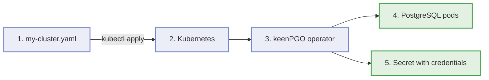
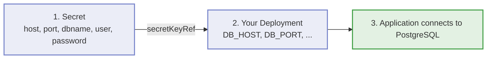

# Quickstart

This guide takes you from an empty Kubernetes cluster to a running PostgreSQL database managed by **keenPGO**. It should take about **ten minutes**.

!!! abstract "What you will learn"

    - Install the keenPGO operator.
    - Create your first PostgreSQL cluster.
    - Find the generated credentials.
    - Connect with `psql` and from an application.
    - Clean everything up when you are done.

!!! tip "Just testing?"

    No cluster yet? Start a local one with [Minikube](Installation/minikube.md) and come back here.

## Contents

<div class="grid cards" markdown>

-   :material-clipboard-check-outline:{ .lg .middle } __Before you start__

    ---

    - [How it works](#how-it-works)
    - [Prerequisites](#prerequisites-for-quickstart)

-   :material-rocket-launch:{ .lg .middle } __Set up__

    ---

    - [Step 1: Install the operator](#step-1-install-the-operator)
    - [Step 2: Create a PostgreSQL cluster](#step-2-create-a-postgresql-cluster)

-   :material-database-lock:{ .lg .middle } __Connect__

    ---

    - [Step 3: Find your credentials](#step-3-find-your-credentials)
    - [Step 4: Connect to the database](#step-4-connect-to-the-database)
    - [Step 5: Connect an application](#step-5-connect-an-application)

-   :material-broom:{ .lg .middle } __Finish__

    ---

    - [Clean up](#clean-up)
    - [Next steps](#next-steps)

</div>

## How it works

The five steps of this guide, from an empty cluster to a connected application:

You write one small YAML file. The operator reads it and builds everything the database needs: pods, disks, services, a user and a password.



## Prerequisites for quickstart

| You need | Details |
| :---- | :---- |
| **Kubernetes** | A running cluster, above version `1.31.x`. |
| **kubectl** | [`kubectl`](https://kubernetes.io/docs/tasks/tools/) configured to reach the cluster. |
| **Permissions** | You must be allowed to create namespaces and the custom resource definitions (CRDs) keenPGO needs. |
| **psql** *(optional)* | The `psql` client, if you want to connect from your own machine to the new database. |

Check that `kubectl` can reach your cluster:

```bash title="Check the cluster"
kubectl get nodes
```

## Step 1: Install the operator

Create a namespace and install keenPGO into it:

```bash title="Install the operator"
kubectl create namespace keenpgo-operator
kubectl apply -n keenpgo-operator -f <operator-manifest-url>
```

!!! note "Prefer Helm, or running on OpenShift?"

    See the [installation guides](Installation/index.md).

Wait until the operator is running:

```bash title="Check the operator"
kubectl get pods -n keenpgo-operator
```

The operator pod should report `Running` and `1/1` ready:

```text title="Expected output"
NAME                       READY   STATUS    RESTARTS   AGE
<operator-pod-name>        1/1     Running   0          30s
```

## Step 2: Create a PostgreSQL cluster

Save the following as `my-cluster.yaml`:

```yaml title="my-cluster.yaml"
apiVersion: <api-group>/<version>
kind: KeenPGCluster
metadata:
  name: my-cluster
  namespace: keenpg-test
spec:
  postgresVersion: 16
  instances:
    - replicas: 2
      storage:
        size: 5Gi
```

What this file asks for:

| Field | Meaning |
| :---- | :---- |
| **name** | The name of your cluster. Lowercase letters, digits and `-`. |
| **namespace** | The project the cluster lives in. |
| **postgresVersion** | The PostgreSQL major version to run. |
| **replicas** | How many PostgreSQL pods you get. `2` or more gives one primary plus replicas, with automatic failover. |
| **storage.size** | The size of the disk for each pod. |

Apply it:

```bash title="Create the cluster"
kubectl apply -f my-cluster.yaml
```

Watch the cluster come up:

```bash title="Watch the pods"
kubectl get pods -n keenpg-test --watch
```

When the database pods show `Running` and ready, the cluster is up. Press ++ctrl+c++ to stop watching.

!!! tip "No passwords to prepare"

    You don't create any password yourself. The operator generates the user, the password and the certificates for you.

## Step 3: Find your credentials

keenPGO creates a user for the cluster and stores the credentials in a Kubernetes Secret named `<secret-name-pattern>`.

List the available fields:

```bash title="List the Secret fields"
kubectl get secret <secret-name> -n keenpg-test -o jsonpath='{.data}' | tr ',' '\n'
```

The Secret contains these values:

| Key | Description |
| :---- | :---- |
| `user` | The database user name. |
| `password` | The password for that user. |
| `dbname` | The default database. |
| `host` | The service name of the primary instance. |
| `port` | The port the database listens on. |
| `uri` | A ready-to-use connection string. |

Read a single value, for example the password:

```bash title="Read the password"
kubectl get secret <secret-name> -n keenpg-test \
  -o jsonpath='{.data.password}' | base64 --decode
```

!!! warning "Keep the credentials safe"

    Treat these credentials like any other secret. Don't paste them into chat, tickets or source control.

## Step 4: Connect to the database

Pick the way that matches where you are:

=== "Port-forward (from your machine)"

    In one terminal, forward the database port:

    ```bash title="Terminal 1"
    kubectl port-forward -n keenpg-test svc/<primary-service-name> 5432:5432
    ```

    In a second terminal, connect with `psql`:

    ```bash title="Terminal 2"
    PGPASSWORD=$(kubectl get secret <secret-name> -n keenpg-test -o jsonpath='{.data.password}' | base64 --decode) \
    psql -h localhost -U <user> -d <dbname>
    ```

=== "From inside the cluster"

    Pods in the same cluster can use the connection string stored in the Secret directly:

    ```bash title="Read the connection string"
    kubectl get secret <secret-name> -n keenpg-test \
      -o jsonpath='{.data.uri}' | base64 --decode
    ```

Once connected, test it:

```sql title="Test the connection"
SELECT version();
```

!!! success "You have a working database"

    If `SELECT version();` returns a PostgreSQL version, your cluster is up and reachable.

## Step 5: Connect an application

Applications should read connection details from the Secret rather than hard-coding them.



Add environment variables to your Deployment that reference the Secret:

```yaml title="Deployment env section"
env:
  - name: DB_HOST
    valueFrom:
      secretKeyRef:
        name: <secret-name>
        key: host
  - name: DB_PORT
    valueFrom:
      secretKeyRef:
        name: <secret-name>
        key: port
  - name: DB_NAME
    valueFrom:
      secretKeyRef:
        name: <secret-name>
        key: dbname
  - name: DB_USER
    valueFrom:
      secretKeyRef:
        name: <secret-name>
        key: user
  - name: DB_PASSWORD
    valueFrom:
      secretKeyRef:
        name: <secret-name>
        key: password
```

!!! tip "The host never changes"

    The `host` value always points to the current primary, even right after a failover. Your application doesn't need to change anything.

## Clean up

To remove the test cluster and the operator:

```bash title="Remove everything"
kubectl delete -f my-cluster.yaml
kubectl delete -n keenpg -f <operator-manifest-url>
kubectl delete namespace keenpg
```

!!! danger "Cleaning up deletes data"

    Deleting the cluster removes its disks and the data on them. Only do this for a test cluster.

## Next steps

<div class="grid cards" markdown>

-   :material-backup-restore:{ .lg .middle } __Back up and restore__

    ---

    Protect your data and recover it when something goes wrong.

    [:octicons-arrow-right-24: Backups](backups.md)

-   :material-shield-lock:{ .lg .middle } __Secure your cluster__

    ---

    Passwords, certificates and access rules.

    [:octicons-arrow-right-24: Security](security.md)

-   :material-lifebuoy:{ .lg .middle } __Troubleshoot__

    ---

    Fix the most common problems.

    [:octicons-arrow-right-24: Troubleshooting](troubleshooting.md)

</div>
